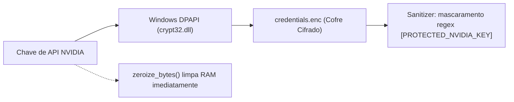
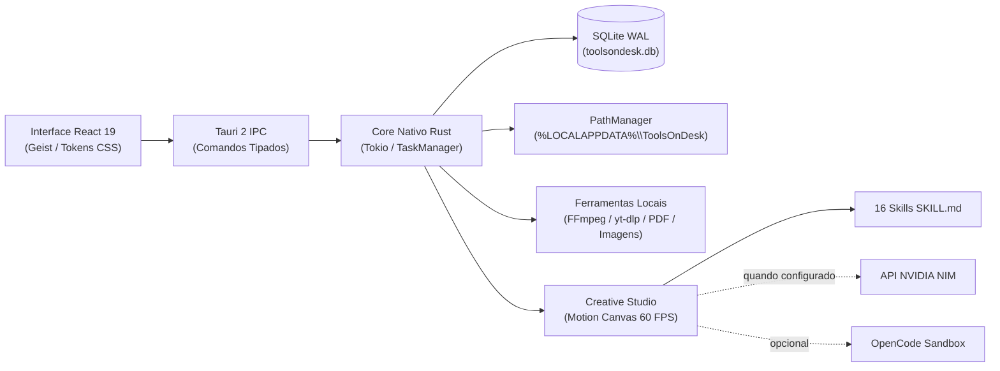

<div align="center">


### Seu espaço de criação. Suas ferramentas. Um só lugar.

**Crie, converta, edite e produza — direto do seu desktop.**

[](#status-do-projeto)
[](https://tauri.app/)
[](https://www.rust-lang.org/)
[](https://react.dev/)
[](#desenvolvimento)
[](#plataformas)
[](#plataformas)
[](#plataformas)
[](#roadmap)

**[Download](#download-versão-portátil-para-testes) · [Landing Page Online](https://mateusarcedev.github.io/tools-on-desk/) · [Visão Geral](#o-que-%C3%A9-o-toolsondesk) · [Recursos](#o-que-voc%C3%AA-pode-fazer) · [Plataformas](#plataformas) · [Segurança & IA](#ia-sem-complica%C3%A7%C3%A3o) · [Desenvolvimento](#desenvolvimento) · [Roadmap](#roadmap)**

<p align="center">
  <br />
  <a href="https://github.com/mateusarcedev/tools-on-desk/releases/download/v0.1.0/toolsondesk.exe">
    
  </a>
  &nbsp;&nbsp;
  <a href="https://github.com/mateusarcedev/tools-on-desk/releases/download/v0.1.0/toolsondesk-windows-x64-portable.zip">
    
  </a>
</p>

</div>

---

> [!NOTE]
> **Histórico do Projeto:** O aplicativo foi fundado, testado e estabilizado ao longo das Missões 01 a 06 sob o nome **Arce Tools**. A partir da **Missão 07**, o produto evoluiu para a marca de trabalho **ToolsOnDesk** (`com.toolsondesk.desktop`), com camada unificada de caminhos (`PathManager`), proteção nativa de credenciais via Windows DPAPI e rotina de migração transacional com preservação integral de dados legados.

---

## O que é o ToolsOnDesk?

O **ToolsOnDesk** é uma suíte desktop offline-first e de alta fidelidade visual que reúne ferramentas essenciais do dia a dia e um estúdio criativo em uma única interface coesa. Converta documentos, processe imagens, trabalhe com áudio e vídeo, crie pôsteres para impressão e explore recursos de criação com inteligência artificial — sem depender de dezenas de sites lentos ou aplicativos dispersos.

Construído sobre a arquitetura moderna do **Tauri 2, Rust e React 19**, o projeto prioriza integração profunda com o sistema operacional, execução local de alto desempenho sempre que possível, tarefas assíncronas em segundo plano com controle de cancelamento e uma experiência simples até para quem não possui conhecimentos técnicos.

> **Estado atual:** versão `0.1.0` em homologação interna. O instalador **Windows x64 (NSIS)** já foi gerado e validado nos testes técnicos do projeto. **Linux e macOS estão no planejamento de portabilidade nativa**, e **Android figura no roadmap futuro**. Não há link de download público anunciado neste README.

---

## O que você pode fazer

<table>
  <tr>
    <td width="50%" valign="top">
      <h3>✦ Creative Studio</h3>
      <p>Crie imagens com IA quando houver modelo disponível para sua conta, prepare briefings guiados, compare propostas lado a lado, explore templates e organize seus projetos visuais.</p>
    </td>
    <td width="50%" valign="top">
      <h3>▶ Motion & Vídeo</h3>
      <p>Monte composições com textos, formas, transições e áudio; visualize animações no player Canvas a 60 FPS e renderize MP4 localmente utilizando o motor Rust e FFmpeg.</p>
    </td>
  </tr>
  <tr>
    <td valign="top">
      <h3>▧ Documentos & PDF</h3>
      <p>Inspecione metadados, una múltiplos PDFs com renumeração de objetos, divida por intervalos ou blocos, reorganize páginas e comprima com algoritmo Deflate. Conversão DOCX/PDF integrada via LibreOffice.</p>
    </td>
    <td valign="top">
      <h3>◫ Imagens & Poster Studio</h3>
      <p>Converta e redimensione imagens com amostragem Lanczos3. Prepare pôsteres em múltiplas folhas com geometria milimétrica, sobreposição (overlap), retícula halftone e silhueta humana proporcional.</p>
    </td>
  </tr>
  <tr>
    <td valign="top">
      <h3>↓ Downloads</h3>
      <p>Gerencie downloads de mídias autorizadas em 13+ plataformas via yt-dlp, extraia áudios em alta fidelidade (MP3/FLAC/WAV/OPUS), com defesa ativa contra SSRF e limpeza de arquivos temporários.</p>
    </td>
    <td valign="top">
      <h3>♫ Áudio & Conversão</h3>
      <p>Converta contêineres e codecs de áudio/vídeo, recorte trechos temporais com precisão, normalize volumes pelo padrão EBU R128 e extraia frames em alta definição.</p>
    </td>
  </tr>
</table>

### Um estúdio criativo que cresce com você

O Creative Studio inclui um catálogo nativo de **16 skills padronizadas com o padrão universal `SKILL.md`** (cobrindo direção de arte, motion design, vídeo, 3D e controle de qualidade), além de **templates prontos para uso** em e-commerce, anúncios, thumbnails e mídias sociais. 

- **OpenCode:** integração opcional detectada automaticamente quando presente no ambiente; o ToolsOnDesk possui um orquestrador fallback 100% nativo em Rust que garante a operação completa do estúdio mesmo sem o OpenCode instalado.
- **Modelos de IA:** os recursos generativos utilizam a **API NVIDIA NIM** quando configurada com uma chave válida. A geração de imagens (FLUX.1, SD 3.5) conecta-se a endpoints de inferência visual; a **composição e renderização de motion design** é 100% local e opera sem necessidade de internet.

> **Nota:** MOTION é um projeto independente em desenvolvimento. Sua futura integração ocorrerá à medida que sua especificação e termos de licenciamento estiverem concluídos.

---

## Plataformas

O objetivo do ToolsOnDesk é oferecer uma experiência **desktop nativa em Windows, Linux e macOS**, compartilhando a mesma identidade visual, projetos e banco de dados local — adaptando integrações específicas de cada sistema operacional.

| Sistema Operacional | Distribuição Pretendida | Estado Atual |
| :-- | :-- | :-- |
| **Windows 11 / x64** | Instalador `.exe` via NSIS (`currentUser`) | **Build interno gerado e testado; homologação concluída** |
| **Linux / x64** | Pacotes `.AppImage`, `.deb` e `.rpm` | **Portabilidade e builds nativos planejados** |
| **macOS / Apple Silicon e Intel** | Aplicativo `.app` e instalador `.dmg` | **Portabilidade, assinatura e notarização planejadas** |
| **Android** | Aplicativo móvel adaptado | **Roadmap futuro; não disponível** |

### O que significa “nativo” aqui?

- **Windows:** executável Rust compilado com toolchain MSVC + WebView2 Runtime do sistema e instalador NSIS.
- **Linux:** executável Rust integrado a WebKitGTK e pacotes nativos da distribuição (`.deb` / `.AppImage`).
- **macOS:** app bundle compilado contra o WebKit do macOS, com requisitos de assinatura digital Apple e notarização.
- **Android (futuro):** interface e capacidades reconstruídas com foco nos padrões ergonômicos e restrições de permissão de dispositivos móveis.

---

## Download (Versão Portátil para Testes)

Para que qualquer pessoa possa testar o **ToolsOnDesk** imediatamente sem precisar passar pelo instalador do Windows, a versão portátil auto-contida está disponível para download direto:

| Arquivo | Formato | Tamanho | Descrição | Link de Download |
|---|:---:|:---:|---|:---:|
| **`toolsondesk.exe`** | Executável Windows (x64) | **14,6 MB** | Executável único standalone. Não requer instalação, basta baixar e abrir. | [**⬇ Baixar .exe direto**](https://github.com/mateusarcedev/tools-on-desk/releases/download/v0.1.0/toolsondesk.exe) |
| **`toolsondesk-windows-x64-portable.zip`** | Pacote ZIP | **6,67 MB** | Arquivo compactado contendo o executável e o manual de testes rápidos. | [**⬇ Baixar Pacote .zip**](https://github.com/mateusarcedev/tools-on-desk/releases/download/v0.1.0/toolsondesk-windows-x64-portable.zip) |

#### Como Executar e Testar:
1. Baixe o executável **[`toolsondesk.exe`](https://github.com/mateusarcedev/tools-on-desk/releases/download/v0.1.0/toolsondesk.exe)**.
2. Dê um duplo clique no arquivo para abrir o aplicativo.
3. **Não requer privilégios de administrador (UAC)** e não faz alterações no Registro do sistema operacional.
4. Toda a interface visual, fontes Geist e motores nativos estão 100% incorporados no executável.
5. Seus dados, banco SQLite, tarefas e projetos são salvos com segurança em `%LOCALAPPDATA%\ToolsOnDesk\`.
6. Se você já usava o Arce Tools, seus dados serão migrados automaticamente na primeira abertura.

---

## Instalação e Testes Avançados

### Opções de Execução

- **Versão Portátil (Recomendada para Testes):** Disponível para download direto acima ou localmente na pasta `release-standalone/toolsondesk.exe`.
- **Instalador Completo NSIS (Para Validação do Instalador):** Disponível no repositório em `src-tauri/target/release/bundle/nsis/ToolsOnDesk_0.1.0_x64-setup.exe` (instalação por usuário dispensando UAC, com criação de atalhos no Menu Iniciar).

#### Primeiro Uso e Configuração:
- O **MigrationModal** confirma a migração transparente caso existam dados legados.
- O **Setup Center** guiará o diagnóstico e o download opcional de utilitários externos (`FFmpeg`, `ffprobe`, `yt-dlp`).
- No **Creative Studio → Configurações IA**, é possível configurar sua chave NVIDIA NIM. Ferramentas locais operam 100% offline.

### Linux e macOS

As versões nativas para Linux e macOS estão em fase de planejamento arquitetural. Os pacotes oficiais serão publicados após a adaptação de dependências de sistema (como WebKitGTK e keychain do macOS) e validação em pipelines de CI dedicadas.

---

## IA sem complicação

O ToolsOnDesk foi projetado para oferecer inteligência artificial generativa sem que o usuário precise configurar ambientes Python, CUDA, terminais ou repositórios Git:

1. Abra o **Creative Studio** (`Ctrl+6`).
2. Adicione sua chave da NVIDIA no cofre seguro, caso utilize modelos de visão.
3. Escolha uma ferramenta, estilo visual (Publicitário, Fotográfico, 3D, Minimalista...) ou template pronto.
4. Gere, ajuste os parâmetros na interface e exporte em alta resolução.



- **Proteção de Credenciais:** No Windows, o ToolsOnDesk utiliza **Windows DPAPI** (`CryptProtectData` via `crypt32.dll`) com entropia da máquina. Chaves nunca são salvas em texto puro no SQLite.
- **Sanitização Contínua:** Expressões de chave (`nvapi-...`) são mascaradas preventivamente em todos os logs e eventos IPC como `[PROTECTED_NVIDIA_KEY]`.
- **Transparência de Quotas:** Modelos indisponíveis na conta NVIDIA do usuário são sinalizados de forma clara, mantendo todas as ferramentas locais do desktop funcionando sem bloqueios.

---

## Projetado para trabalhar localmente



- **Interface:** React 19, TypeScript em modo estrito, Vite 8 e tipografia local `Geist` / `Geist Mono`.
- **Desktop Shell:** Tauri 2, barra de título frameless customizada com controles integrados e tema Dark/Light.
- **Core Nativo:** Rust 1.84+ (MSVC ABI), fila de tarefas concorrente assíncrona com tokens de cancelamento.
- **Dados:** SQLite em modo WAL com transações atômicas e **SQLite Online Backup API** para snapshots.
- **Caminhos Centralizados:** Gestão unificada via `PathManager` sob `%LOCALAPPDATA%\ToolsOnDesk\`.

---

## Métricas Reais do Pacote Oficial (Windows 11 x64)

Medições realizadas em ambiente de homologação com os binários gerados pela toolchain MSVC:

| Indicador Técnico | Medição Real | Referência de Engenharia |
|---|:---:|:---:|
| **Instalador Oficial NSIS** | **5.061.863 bytes (4,83 MiB)** | `ToolsOnDesk_0.1.0_x64-setup.exe` |
| **Hash SHA-256 do Instalador** | `A0CE89249AA8BE4DCFC79E602B5513AA060F53BE991279B04B2044D4D90894CE` | Verificado via PowerShell |
| **Executável Principal** | **14.662.144 bytes (13,98 MiB)** | `toolsondesk.exe` |
| **Hash SHA-256 do Executável** | `CCE9A3CE1E80EEC8ABCF604BC8A6E573FE40D6EA91B8A44D2E1368FF465CEC68` | Verificado via PowerShell |
| **Tempo de Inicialização a Frio** | **1,69 s** | < 3,00 s |
| **Tempo de Inicialização a Quente** | **0,93 s** | < 1,50 s |
| **Memória RAM — Processo Rust** | **~28 MB** | < 40 MB |
| **Memória RAM — Total em Repouso** | **~141 MB** | < 180 MB |
| **Taxa de Quadros da Interface & Player** | **60 FPS estáveis** | 60 FPS |

---

## Desenvolvimento

**Pré-requisitos:** Node.js 20+, pnpm 10+, Rust stable com toolchain `x86_64-pc-windows-msvc`, Microsoft C++ Build Tools e WebView2 Runtime.

```bash
# 1. Instalar dependências do frontend
pnpm install

# 2. Executar testes automatizados do frontend (34 testes Vitest em 9 suítes)
pnpm test

# 3. Compilar frontend de forma estrita (TypeScript + Vite)
pnpm build

# 4. Executar testes automatizados do backend Rust (29 testes nativos MSVC)
cargo test --manifest-path src-tauri/Cargo.toml

# 5. Compilar o executável de produção release
cargo build --release --manifest-path src-tauri/Cargo.toml

# 6. Gerar o instalador oficial Windows (NSIS)
cargo tauri build --bundles nsis
```

### Estrutura de Diretórios

```text
.
├── public/                 # Identidade visual, logos SVG e fontes Geist/Geist Mono
├── src/                    # Interface React 19, telas, componentes e serviços
│   ├── components/         # Shell, Poster Studio, Creative Studio, Setup Center, Migração
│   ├── services/           # Camada de comunicação IPC tipada com o Tauri
│   ├── styles/             # Tokens CSS oficiais (cores, tipografia, elevações)
│   └── types/              # Interfaces estritas TypeScript
├── src-tauri/              # Backend nativo em Rust
│   ├── icons/              # Conjunto completo de ícones (ICO, ICNS, PNG)
│   └── src/
│       ├── commands/       # Handlers de comandos IPC (mídia, tarefas, IA, migração)
│       ├── engines/        # Motores: Poster, Imagem, Motion, Skills, DependencyManager
│       ├── storage/        # Banco de dados SQLite, migrações e auditoria
│       └── utils/          # PathManager, DPAPI Vault, Sanitizer e identificação
├── docs/                   # Documentação técnica e registros de engenharia
└── README.md
```

---

## Documentação Técnica do Projeto

| Documento | Descrição |
|---|---|
| [Arquitetura do Sistema](./docs/ARCHITECTURE.md) | Especificação de IPC, subsistemas Rust e ciclo de vida |
| [Decisões de Arquitetura (ADRs)](./docs/DECISIONS.md) | Registros formais de decisões técnicas de ADR 001 a ADR 026 |
| [Plano de Rebranding e Migração](./docs/REBRANDING-MIGRATION-PLAN.md) | Estratégia completa da transição Arce Tools $\to$ ToolsOnDesk |
| [Migração de Dados](./docs/DATA-MIGRATION.md) | Detalhes da máquina de estados e SQLite Online Backup |
| [Cofre de Credenciais e DPAPI](./docs/CREDENTIAL-MIGRATION.md) | Arquitetura criptográfica da Windows Data Protection API |
| [Estratégia de Upgrade Windows (NSIS)](./docs/WINDOWS-UPGRADE-STRATEGY.md) | Comportamento de coexistência, atalhos e desinstalação |
| [Relatório de Testes de Migração](./docs/MIGRATION-TEST-REPORT.md) | Matriz completa cobrindo os 21 cenários de teste |
| [Creative Studio](./docs/CREATIVE-STUDIO.md) | Guia do estúdio criativo, motion design e IA generativa |
| [Biblioteca de Skills Criativas](./docs/CREATIVE-SKILLS.md) | Especificação das 16 skills no padrão `SKILL.md` |
| [Gerenciador de Dependências](./docs/DEPENDENCY-MANAGER.md) | Descoberta, integridade SHA-256 e Zip Slip protection |
| [Central de Erros e Diagnósticos](./docs/ERROR-DIAGNOSTICS.md) | Persistência SQLite, sanitização em 7 camadas e filtros |
| [Validação do Instalador Windows](./docs/INSTALLER-VALIDATION.md) | Medições do pacote gerado pelo empacotador NSIS |
| [Critérios de Prontidão (M07)](./docs/RELEASE-READINESS-M07.md) | Checklist de conformidade técnica e homologação |

---

## Roadmap

- [x] Fundação desktop com Tauri 2, React 19 e Rust MSVC.
- [x] Conversores reais de mídia, downloads (yt-dlp), Document Engine e Poster Studio avançado.
- [x] Central de Erros persistente, histórico relacional e Setup Center interativo.
- [x] Creative Studio com geração visual por IA, Motion Engine Canvas 60 FPS e 16 skills `SKILL.md`.
- [x] Rebranding para ToolsOnDesk com `PathManager`, cofre Windows DPAPI e migração transacional.
- [x] Geração e validação do instalador oficial Windows NSIS (`currentUser`).
- [ ] Homologação formal em máquina Windows limpa com usuário convidado.
- [ ] Depósito de registro da marca ToolsOnDesk no INPI (Classes 09 e 42) e domínio web.
- [ ] Aquisição de certificado digital comercial EV/OV para assinatura Authenticode do Windows.
- [ ] **Portabilidade e builds nativos para Linux**, com pacotes `.AppImage` e `.deb`.
- [ ] **Portabilidade e builds nativos para macOS**, com binários Apple Silicon/Intel e `.dmg`.
- [ ] Pipeline de CI/CD automatizado para builds multiplataforma com testes integrados.
- [ ] Integração do projeto MOTION quando suas especificações e licenças estiverem concluídas.
- [ ] Sistema de atualização silenciosa assinada (`@tauri-apps/plugin-updater`).
- [ ] Explorar **versão mobile adaptada para Android**.

---

## Status do Projeto e Governança

**`v0.1.0` · Homologação Interna · Desenvolvimento Ativo**

Os resultados de testes automatizados e builds reportados representam validações técnicas de desenvolvimento. O aplicativo **não deve ser publicado externamente** até a conclusão do processo marcário junto ao INPI, compra do domínio corporativo e obtenção de certificado comercial de assinatura de código.

## Segurança, Serviços e Licenças

- **Isolamento Local vs Nuvem:** Processamento local (áudio, vídeo, documentos, pôsteres e motion) opera 100% offline; integrações em nuvem (NVIDIA NIM) exigem configuração consciente de chave e acesso de rede.
- **Proteção de Dados:** Credenciais são cifradas nativamente via Windows DPAPI e buffers de memória são higienizados com `zeroize_bytes`.
- **Softwares de Terceiros:** FFmpeg (LGPL/GPL), yt-dlp (The Unlicense), LibreOffice (MPL v2.0) e outros utilitários são invocados como subprocessos externos isolados em estrita conformidade com suas respectivas licenças.
- **Propriedade e Direitos:** A marca ToolsOnDesk e o código da aplicação são de uso e distribuição restritos até definição formal de licença de lançamento.

---

<div align="center">

**ToolsOnDesk**

*Menos aplicativos abertos. Mais ideias realizadas.*

**Create · Convert · Make**

</div>
