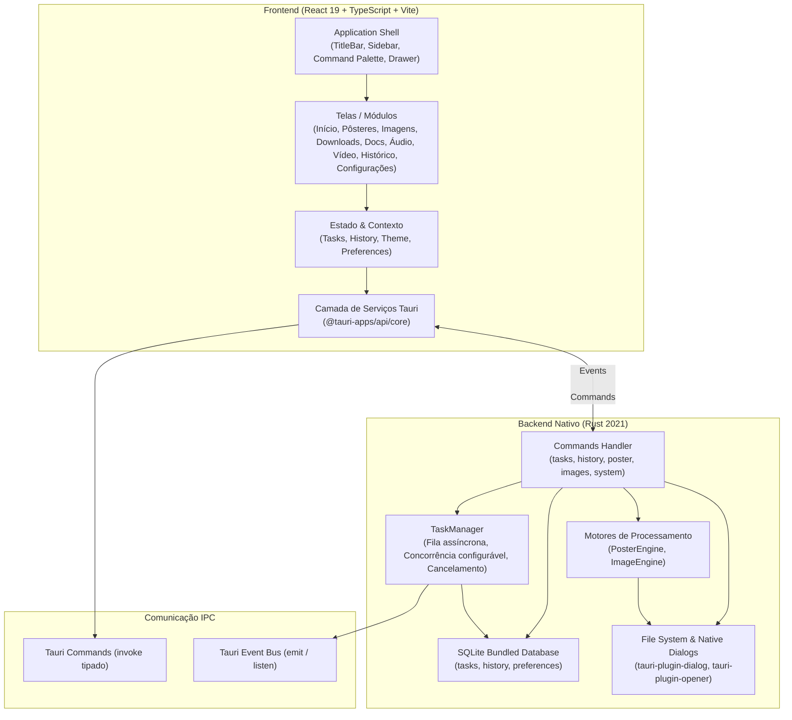

# ARCE TOOLS — Arquitetura do Sistema

Documento de especificação técnica e arquitetura da aplicação desktop **Arce Tools**.

---

## 1. Visão Geral

O **Arce Tools** é um aplicativo desktop multiferramentas offline-first, de alta fidelidade visual e baixo consumo de recursos, projetado nativamente para Windows 11 (x64) com suporte para Linux e macOS.

A arquitetura adota o modelo desacoplado do **Tauri 2**, separando estritamente a interface do usuário (Webview2 / React 19) do motor de execução nativo de alto desempenho (Rust / Tokio / SQLite).

---

## 2. Camadas do Frontend

Localizado em `/src`:

### 2.1 Design System e Tokens (`/src/styles/tokens.css`)
- **Tokens de Cor**:
  - Dark Theme: Fundo `#0B0F10`, Superfície `#141A1C`, Borda `#1F292B`, Acento Menta `#15F5BA`, Texto Primário `#F3F4F6`.
  - Light Theme: Fundo `#F8FAFC`, Superfície `#FFFFFF`, Borda `#E2E8F0`, Acento Menta `#076B39`, Texto Primário `#0F172A`.
- **Tipografia**: `Geist` (Interface e títulos), `Geist Mono` (Métricas, atalhos, códigos e especificações técnicas). Fontes embarcadas localmente em `/public/fonts/` sem dependência de internet.
- **Microinterações e Animações**: Transições de 150ms a 200ms (`ease-out`), scrollbars customizadas de 6px com cantos arredondados, focus-visible acessível em mint.

### 2.2 Shell da Aplicação (`/src/components/shell/`)
- `TitleBar.tsx`: Barra de título nativa com controles de janela (minimizar, maximizar, fechar), logotipo Arce Tools com badge do motor nativo e indicador de tarefas ativas.
- `Sidebar.tsx`: Navegação lateral recolhível (expandido 230px, recolhido 64px) com contadores em tempo real e atalhos de teclado (Ctrl+1 a Ctrl+9).
- `CommandPalette.tsx`: Painel de navegação rápida acionado globalmente por `Ctrl+K`, permitindo filtrar ferramentas e executar ações imediatas.
- `TaskDrawer.tsx`: Gaveta lateral de tarefas ativa acionada por `Ctrl+J` ou pelo botão na barra de status, exibindo progresso em tempo real, velocidade e botão de cancelamento individual.
- `StatusBar.tsx`: Barra inferior com status de conexão com o backend Rust, versão do aplicativo, tarefas ativas e acesso rápido ao tema.

### 2.3 Camada de Serviços Tauri (`/src/services/tauri.ts`)
Encapsula todas as chamadas `invoke` e `listen` com tipagem estrita TypeScript, garantindo que o frontend nunca realize chamadas ad-hoc sem validação de tipos. Fornece métodos de fallback elegantes para testes unitários em ambiente de navegador.

---

## 3. Camadas do Backend Rust

Localizado em `/src-tauri`:

### 3.1 Gerenciador Global de Tarefas (`/src-tauri/src/tasks/manager.rs`)
- Fila mpsc assíncrona gerenciada pelo Tokio runtime.
- Controle de concorrência por semáforo configurável (padrão: 3 tarefas simultâneas, ajustável nas preferências).
- Suporte a tokens de cancelamento cooperativo (`tokio_util::sync::CancellationToken`).
- Persistência contínua de status em SQLite (`pending`, `running`, `completed`, `failed`, `canceled`).
- Broadcast de eventos em tempo real para a interface via `app.emit("task://...", payload)`.
- **Recuperação de reinicializações**: No startup, qualquer tarefa que tenha permanecido em estado `running` ou `pending` devido a encerramento repentino do processo é automaticamente marcada como `failed` com mensagem `"Interrompido pela reinicialização do aplicativo"`.

### 3.2 Persistência e Banco de Dados (`/src-tauri/src/storage/db.rs`)
- SQLite embutido via `rusqlite` com recurso `bundled`, dispensando bibliotecas nativas externas DLL/so no sistema operacional.
- Modo WAL (`PRAGMA journal_mode=WAL`) e `PRAGMA synchronous=NORMAL` para operações concorrentes ultra-rápidas.
- Tabelas:
  - `tasks`: Histórico e estado atual da fila de processamento.
  - `history`: Registro permanente de arquivos gerados/convertidos, tamanho, duração e caminhos no disco.
  - `preferences`: Chave-valor para preferências do usuário (tema, limite de concorrência, pasta padrão).

### 3.3 Motores de Processamento Nativo (`/src-tauri/src/engines/`)

#### A. Poster Studio Engine (`poster_engine.rs`)
Gera PDFs multipágina compatíveis com a especificação **PDF 1.4**, com precisão física em milímetros:
- Cálculo rigoroso de proporção física ($1\text{ mm} = 72 / 25.4\text{ pt} \approx 2.834645669\text{ pt}$).
- Suporte a folhas A4 ($210 \times 297\text{ mm}$) e A3 ($297 \times 420\text{ mm}$) em orientações Retrato ou Paisagem.
- Cálculo de margens físicas imprimíveis (padrão 10mm).
- Cálculo de sobreposição entre folhas (overlap, padrão 5mm) para montagem e colagem sem descontinuidades.
- Cálculo dinâmico do **DPI efetivo de impressão**:
  $$\text{DPI} = \frac{\text{Largura em Pixels}}{\text{Largura Total em Polegadas}}$$
  Alerta visual quando $\text{DPI} < 150$.
- Desenho vetorial de marcas de corte nos 4 cantos da área útil.
- Numeração automática no rodapé de cada folha (`Folha X de Y (Linha R, Coluna C)`).
- Fatiamento de imagem por viewport sem duplicação de buffers de memória (leitura e encoding JPEG direto via `CountingWriter`).

#### B. Image Engine (`image_engine.rs`)
Processamento de imagens em lote baseado no crate `image`:
- Conversão segura entre PNG e JPEG.
- Redimensionamento por amostragem **Lanczos3** de alta fidelidade visual.
- Preservação estrita de proporção de aspecto (aspect ratio).
- Ajuste de qualidade JPEG (1 a 100).
- Compilação de múltiplas imagens em um único arquivo PDF com dimensões adaptadas por página.
- Prevenção automática de sobrescrita de arquivos (`nome (1).ext`, `nome (2).ext`).

---

## 4. Contratos IPC (Tauri Commands)

| Comando | Parâmetros | Retorno | Descrição |
|---|---|---|---|
| `get_tasks` | Nenhum | `Vec<Task>` | Lista todas as tarefas persistidas |
| `get_active_tasks` | Nenhum | `Vec<Task>` | Lista tarefas em execução ou pendentes |
| `cancel_task` | `task_id: String` | `()` | Solicita o cancelamento imediato da tarefa |
| `clear_completed_tasks`| Nenhum | `()` | Remove tarefas finalizadas da visualização |
| `get_history` | Nenhum | `Vec<HistoryItem>` | Retorna histórico completo ordenado por data |
| `clear_history` | Nenhum | `()` | Limpa a tabela de histórico |
| `delete_history_item` | `id: String` | `()` | Remove um registro específico do histórico |
| `calculate_poster_metrics` | `options: PosterOptions` | `PosterMetrics` | Calcula páginas, linhas, dimensões e DPI |
| `generate_poster` | `options: PosterOptions` | `String (task_id)` | Enfileira a geração do pôster no TaskManager |
| `convert_image` | `options: ImageConvertOptions` | `String (task_id)` | Enfileira conversão individual ou em lote |
| `images_to_pdf` | `options: ImagesToPdfOptions` | `String (task_id)` | Enfileira a criação de PDF de imagens |
| `get_system_info` | Nenhum | `SystemInfo` | Retorna pastas do sistema, cores e versão |
| `get_preferences` | Nenhum | `UserPreferences` | Carrega configurações salvas em SQLite |
| `save_preferences` | `prefs: UserPreferences`| `()` | Persiste configurações do usuário |

---

## 5. Eventos Tauri (Backend -> Frontend)

| Evento | Payload | Descrição |
|---|---|---|
| `task://created` | `Task` | Nova tarefa adicionada à fila |
| `task://progress` | `TaskProgressPayload` | Progresso atualizado (0-100%), mensagem e velocidade |
| `task://completed` | `Task` | Tarefa concluída com sucesso |
| `task://failed` | `Task` | Tarefa falhou com mensagem de erro detalhada |
| `task://canceled` | `Task` | Tarefa cancelada pelo usuário |
