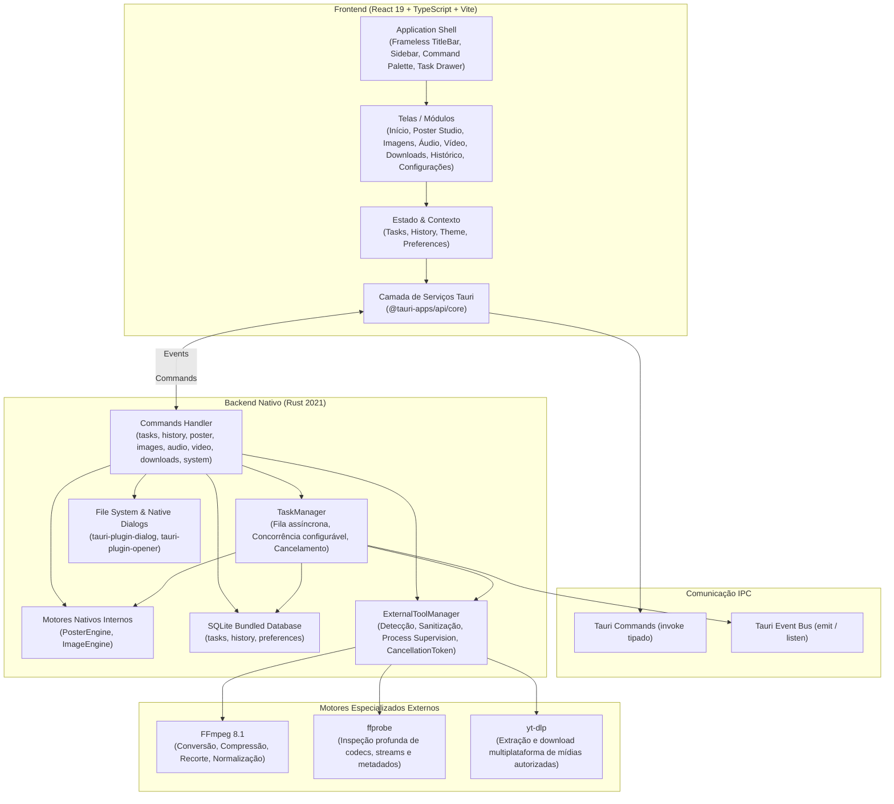

# ARCE TOOLS — Arquitetura do Sistema

Documento de especificação técnica e arquitetura da aplicação desktop **Arce Tools** (Missões 01, 02 e 02.5).

---

## 1. Visão Geral

O **Arce Tools** é um aplicativo desktop multiferramentas offline-first, de alta fidelidade visual e baixo consumo de recursos, projetado nativamente para Windows 11 (x64) com suporte para Linux e macOS.

A arquitetura adota o modelo desacoplado do **Tauri 2**, separando estritamente a interface do usuário (Webview2 / React 19) do motor de execução nativo de alto desempenho (Rust / Tokio / SQLite) e dos motores externos especializados (**FFmpeg**, **ffprobe**, **yt-dlp**).

---

## 2. Camada de Motores Externos (`ExternalToolManager`)

Localizado em [`src-tauri/src/engines/external_tools.rs`](file:///home/mateusarcedev/projetos/arce-tools/src-tauri/src/engines/external_tools.rs):

### 2.1 Políticas Rígidas de Execução e Segurança
1. **Sem Injeção de Shell:** A execução de processos ocorre exclusivamente via `tokio::process::Command::new(binary_path).args(arg_vec)`. Nenhuma chamada passa por `cmd.exe /c` ou `powershell -Command`.
2. **Defesa contra SSRF:** Bloqueio prévio de endereços locais (`localhost`, `127.0.0.1`, `::1`), faixas privadas RFC 1918 (`10.*`, `172.16-31.*`, `192.168.*`) e metadados de nuvem/link-local (`169.254.*`).
3. **Sem Janelas Pretas:** No Windows, o processo é criado com a flag `CREATE_NO_WINDOW = 0x08000000`, mantendo a execução 100% invisível ao usuário final.
4. **Supervisão e Cancelamento Imediato:** Loops de processamento escutam tokens atômicos de cancelamento (`AtomicBool`). Caso o usuário cancele a tarefa, o subprocesso filho recebe um comando `child.kill().await` imediato, evitando processos zumbis ou vazamento de recursos.
5. **Limpeza de Arquivos Temporários:** Em caso de erro ou cancelamento no meio de uma conversão de áudio ou vídeo, arquivos parciais corrompidos são automaticamente deletados do disco.

### 2.2 Descoberta de Executáveis
A resolução de binários segue ordem determinística:
1. Pasta de binários locais da aplicação (`./binaries/` ou ao lado do executável em produção).
2. Diretórios conhecidos de instalação do WinGet em `%LOCALAPPDATA%\Microsoft\WinGet\Packages\...`.
3. Variável de ambiente `PATH` do sistema.

---

## 3. Motores Multimídia Implementados

### 3.1 MediaEngine (`media_engine.rs`)
Responsável pela inspeção não-bloqueante de arquivos de mídia via `ffprobe -v quiet -print_format json -show_format -show_streams`:
- Extração de duração física exata, tamanho em bytes e taxa de bits global.
- Detecção de streams de vídeo: resolução (largura $\times$ altura), taxa de quadros (FPS calculada de frações como 30000/1001 ou 30/1) e codec.
- Detecção de streams de áudio: taxa de amostragem (ex.: 44100 Hz), número de canais e codec.

### 3.2 AudioEngine (`audio_engine.rs`)
- **Conversão de Formatos:** MP3 (via `libmp3lame`), WAV (`pcm_s16le`), FLAC (`flac`), M4A/AAC (`aac`), OGG (`libvorbis`), OPUS (`libopus`).
- **Normalização de Volume:** Aplicação do padrão broadcast EBU R128 (`loudnorm=I=-14:LRA=11:TP=-1.5`).
- **Corte por Intervalo:** Segmentação temporal precisa por início e fim em segundos (`-ss` e `-to`).
- **Progresso Real:** Parser estruturado do output `-progress pipe:1 -nostats` calculando $\text{progresso} = \text{tempo decorrido} / \text{duração total}$.

### 3.3 VideoEngine (`video_engine.rs`)
- **Conversão de Formatos:** MP4, MKV e WEBM (`libx264`, `libx265`, `libvpx-vp9`).
- **Compressão de Vídeo:** Presets de taxa constante (CRF 18 para alta qualidade, CRF 23 para equilibrado, CRF 28 para arquivo menor).
- **Redimensionamento:** Escala proporcional adaptada (`scale=-2:1080`, `scale=-2:720`, `scale=-2:480`).
- **Modos de Corte:**
  - *Corte Rápido:* `-c copy` instantâneo sem perda de qualidade, alinhado aos keyframes mais próximos.
  - *Corte Preciso:* recodificação quadro a quadro com precisão exata.
- **Extração de Áudio e Frames:** Extração de áudio diretamente da trilha do vídeo ou captura de imagem estática (JPG/PNG) em um timestamp selecionado.

### 3.4 DownloadEngine (`download_engine.rs`)
- **Reconhecimento de 13+ Plataformas:** YouTube, Shorts, Instagram, Reels, TikTok, Facebook, X (Twitter), Reddit, Pinterest, Vimeo, Twitch, SoundCloud, Dailymotion e genérico.
- **Inspeção de Playlists:** `--dump-single-json --flat-playlist` para extração de índices, títulos e durações sem pré-download.
- **Download em Lote:** Enfileiramento em lote via textarea no TaskManager.
- **Formatos de Extração de Áudio:** MP3, M4A, WAV, FLAC e OPUS.
- **Defesa Rigorosa contra SSRF:** Rejeição de requisições a loopbacks e redes privadas.
- **Auditoria de Versão:** Comando `get_ytdlp_status` verificando versão e procedência.

### 3.5 PosterEngine (`poster_engine.rs`)
- **Paridade Rasterbator.net & Além:**
  - Suporte a papéis A4, A3, Letter, Legal e Personalizado.
  - Orientação Retrato / Paisagem.
  - Cálculo físico milimétrico de margens e sobreposição de montagem (*overlap*).
  - Silhueta humana proporcional de 1,80 m com alternância on/off no viewport.
  - Indicador em tempo real de DPI efetivo com faixas de qualidade.
  - Efeitos artísticos: Original, P&B, Halftone Monocromático (círculos e quadrados antialiased com pitch e min/max dot size configuráveis), Halftone Colorido, Dithering Floyd-Steinberg e Alto Contraste.
  - Geração de PDF via `printpdf` com marcas de corte e legendas alfanuméricas de montagem.
  - Renderizador de preview Rust em tempo real retornando base64 (`render_poster_preview`).

### 3.6 DocumentEngine (`document_engine.rs` — Missão 03)
- **PDF Inspector (`inspect_pdf`):** Inspeciona contagem de páginas, versão do formato PDF, dimensões de folha e presença de fluxos de texto vs digitalizações.
- **União Estrutural de PDFs (`merge_pdfs`):** Fusão sem colisões através do algoritmo seguro de renumeração de identificadores de nós de objetos indiretos (`lopdf 0.46`).
- **Divisão de PDFs (`split_pdf`):** Divisão por páginas individuais, intervalos customizados (ex: `1-3, 5, 8-10`) e blocos de $N$ páginas, com opção de consolidar a seleção em documento único.
- **Organizador e Rotacionador de Páginas (`organize_pdf`):** Reordenação, rotação de 90° em 90° e exclusão de páginas, sempre gerando um novo arquivo de saída sem sobrescrever o original.
- **Compressão Estrutural de PDF (`compress_pdf`):** Remoção de nós órfãos de dicionários (`prune_objects`) e recompressão de fluxos via algoritmo Deflate sem perdas.
- **Conversor Word para PDF (`convert_word_to_pdf`):** Execução do LibreOffice em modo headless com isolamento estrito de perfil (`-env:UserInstallation=file:///<temp_profile>`) e bloqueio de macros, prevenindo interferência em instâncias do usuário.
- **Conversor PDF para Word (`convert_pdf_to_docx`):** Extração de texto e estruturação em parágrafos e títulos diretamente em formato OpenXML (.docx) via `docx-rs`.

### 3.7 Central de Erros e Diagnósticos (`db.rs` e `sanitizer.rs` — Missões 03 e 04)
- **Persistência Indexada em SQLite:** Tabela `error_logs` com índices dedicados em `created_at`, `severity`, `module`, `status`, `task_id` e `error_code`.
- **Pipeline de Sanitização Multicamadas:** 7 camadas de expressões regulares com lookahead guard negativo `[^\[...]`, eliminando segredos, credenciais, cabeçalhos HTTP (`Authorization`, `Cookie`), blocos de chaves privadas e caminhos confidenciais (`C:\Users\[USER]\...`).
- **Deduplicação Temporal de Eventos:** Janela de descarte de 3 segundos em `Db::insert_error_log` para impedir inundações do banco em falhas repetitivas em lote.
- **Acesso Nativo ao Clipboard Win32:** Interação direta com as APIs `OpenClipboard` e `SetClipboardData` via crate `arboard 3.7`.
- **Exportações Globais:** Consulta não-paginada de todo o histórico no SQLite via `get_all_error_logs_for_export`, permitindo cópia e exportação integral em formatos estruturados TXT e JSON.

---

## 4. Contratos IPC Atualizados (Tauri Commands)

| Comando | Parâmetros | Retorno | Descrição |
|---|---|---|---|
| `probe_media` | `filePath: String` | `MediaInfo` | Inspeção profunda de codecs, streams e duração via ffprobe |
| `start_audio_convert` | `options: AudioConvertOptions` | `String (task_id)` | Enfileira conversão de áudio no TaskManager |
| `start_audio_trim` | `options: AudioTrimOptions` | `String (task_id)` | Enfileira corte de áudio por intervalo |
| `start_video_convert` | `options: VideoConvertOptions` | `String (task_id)` | Enfileira conversão de vídeo com codec e CRF |
| `start_video_compress`| `options: VideoCompressOptions`| `String (task_id)` | Enfileira compressão com presets de qualidade |
| `start_video_trim` | `options: VideoTrimOptions` | `String (task_id)` | Enfileira corte rápido ou preciso de vídeo |
| `start_video_extract_audio` | `options: VideoExtractAudioOptions` | `String (task_id)` | Extrai trilha sonora do vídeo para áudio |
| `start_video_extract_frame` | `options: VideoExtractFrameOptions` | `String (task_id)` | Extrai imagem estática de um frame |
| `fetch_download_info`| `url: String` | `MediaDownloadInfo` | Obtém título, miniatura, plataforma e itens de playlist |
| `get_ytdlp_status` | Nenhum | `YtDlpStatus` | Retorna versão, caminho e disponibilidade do yt-dlp |
| `start_download` | `options: DownloadOptions` | `String (task_id)` | Enfileira download de vídeo ou áudio via yt-dlp |
| `check_external_tools`| Nenhum | `ExternalToolsStatus`| Retorna versão, caminho e licença de FFmpeg, ffprobe e yt-dlp |
| `get_tasks` | Nenhum | `Vec<Task>` | Lista todas as tarefas persistidas |
| `cancel_task` | `id: String` | `()` | Cancela a tarefa e encerra subprocessos associados via `taskkill /F /T` |
| `retry_task` | `id: String` | `()` | Re-enfileira tarefa falha ou cancelada |
| `calculate_poster_spec`| `options: PosterOptions`| `PosterSpec` | Calcula colunas, linhas, páginas, dimensões montadas, DPI e razão de escala humana |
| `render_poster_preview`| `options: PosterOptions`| `String (data_url)`| Gera preview processado em base64 com efeitos artísticos em tempo real |
| `start_poster_task` | `options: PosterOptions` | `String (task_id)` | Enfileira geração de PDF multipágina do pôster |
| `start_image_conversion_task` | `options: ImageConvertOptions` | `String (task_id)` | Enfileira conversão/resize de imagens |
| `start_images_to_pdf_task` | `options: ImagesToPdfOptions` | `String (task_id)` | Enfileira compilação de imagens em PDF |
| `inspect_pdf` | `filePath: String` | `PdfInspectionInfo` | Inspeciona páginas, dimensões e texto de PDF |
| `start_pdf_merge` | `options: PdfMergeOptions` | `String (task_id)` | Enfileira fusão estrutural de PDFs |
| `start_pdf_split` | `options: PdfSplitOptions` | `String (task_id)` | Enfileira divisão de PDF por páginas/intervalos |
| `start_pdf_organize` | `options: PdfOrganizeOptions` | `String (task_id)` | Enfileira organização/rotação/exclusão de páginas |
| `start_pdf_compress` | `options: PdfCompressOptions` | `String (task_id)` | Enfileira compressão estrutural Deflate de PDF |
| `start_word_to_pdf` | `options: WordToPdfOptions` | `String (task_id)` | Enfileira conversão DOCX para PDF via LibreOffice headless |
| `start_pdf_to_word` | `options: PdfToWordOptions` | `String (task_id)` | Enfileira extração e conversão PDF para DOCX |
| `check_libreoffice_status` | Nenhum | `LibreOfficeStatus` | Verifica presença e caminho do LibreOffice no sistema |
| `get_error_logs` | `filter: ErrorFilterOptions` | `ErrorLogsResponse` | Retorna lista paginada e filtrada de erros do SQLite |
| `get_all_error_logs_for_export` | `filter: Option<ErrorFilterOptions>` | `Vec<ErrorLogEntry>` | Retorna todo o histórico não-paginado para exportação/cópia |
| `resolve_error_log` | `id: String` | `()` | Marca o erro como resolvido com timestamp |
| `reopen_error_log` | `id: String` | `()` | Reabre um erro previamente resolvido |
| `clear_error_logs` | `olderThanDays: Option<u32>` | `u64` | Limpa erros respeitando a política de retenção |
| `get_error_stats` | Nenhum | `ErrorStats` | Retorna contagens de erros e tamanho do banco em KB |
| `copy_to_clipboard` | `text: String` | `()` | Copia texto diretamente para a área de transferência Win32 |
| `get_system_info` | Nenhum | `SystemInfo` | Pastas padrão do sistema e SO |
| `open_path_in_explorer` | `path: String` | `()` | Revela arquivo ou pasta no Windows Explorer |

---

## 5. Arquitetura de Empacotamento e Distribuição Windows (Missão 04)

1. **Instalador Oficial NSIS Nativo**: Empacota o executável Rust e os assets do frontend compilados em um instalador assinado e autocontido de 3,97 MB (`Arce Tools_0.1.0_x64-setup.exe`).
2. **Desacoplamento de Utilitários Pesados**: Os utilitários FFmpeg e yt-dlp (~480 MB) são mantidos desacoplados, com suporte a detecção em cascata (App Dir $\rightarrow$ LocalAppData $\rightarrow$ WinGet $\rightarrow$ PATH) e instalação assistida com um clique na aba Configurações.
3. **Desinstalação Limpa**: Registro completo no Painel de Controle do Windows com limpeza de arquivos temporários e atalhos no Menu Iniciar.
