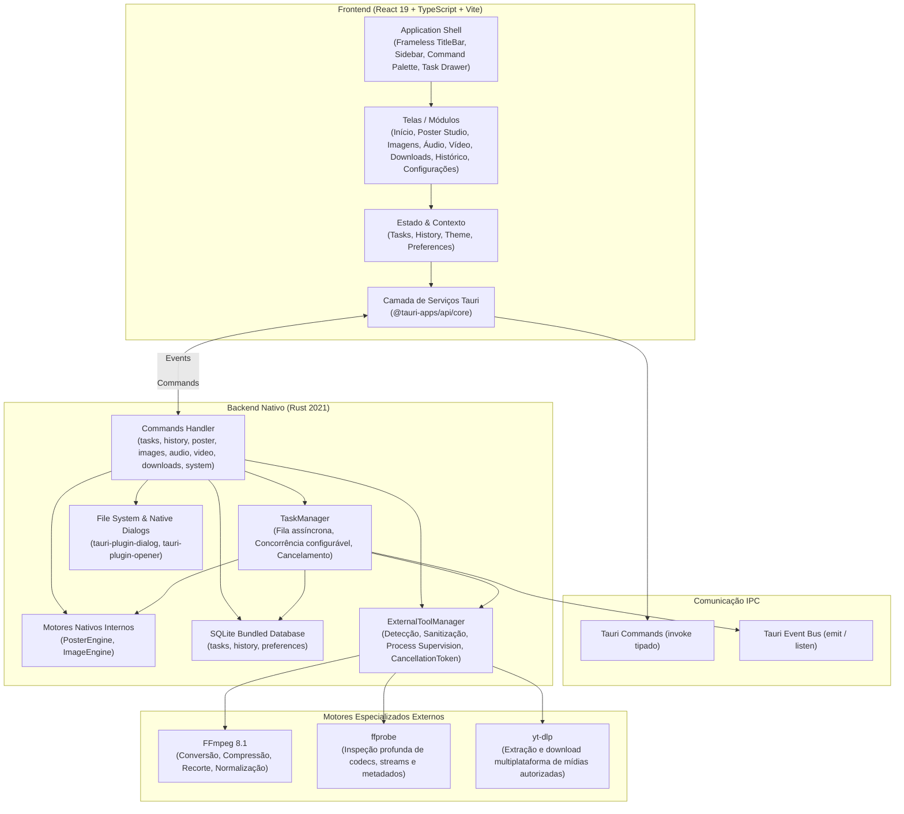
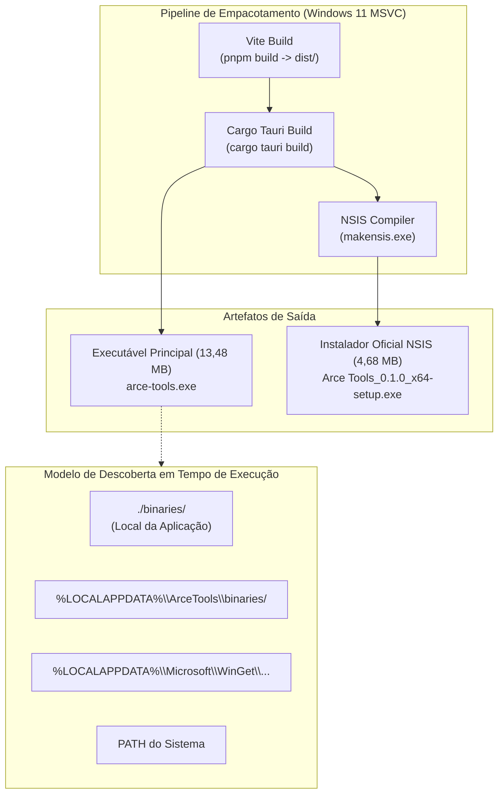
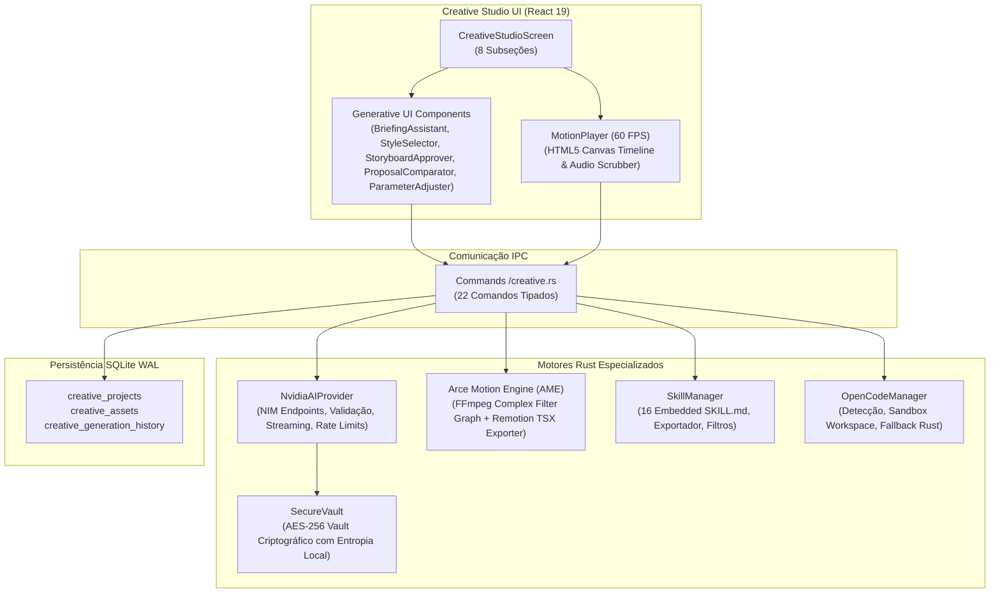
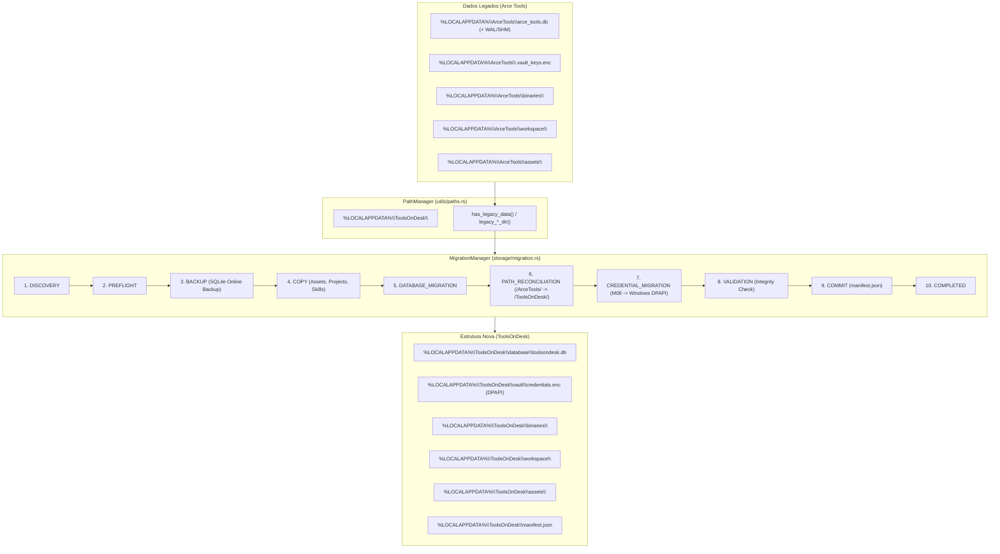

# ToolsOnDesk (ex-Arce Tools) — Arquitetura do Sistema

Documento de especificação técnica e arquitetura da aplicação desktop **ToolsOnDesk** (Missões 01 a 07).

> [!NOTE]
> **Histórico:** Desenvolvido originalmente como **Arce Tools** (M01–M06). A partir da **Missão 07**, o projeto adotou a identidade de trabalho **ToolsOnDesk**, com identificador `com.toolsondesk.desktop` e infraestrutura de caminhos centralizada.

---

## 1. Visão Geral

O **ToolsOnDesk** é um aplicativo desktop multiferramentas offline-first, de alta fidelidade visual e baixo consumo de recursos, projetado nativamente para Windows 11 (x64) com suporte para Linux e macOS.

A arquitetura adota o modelo desacoplado do **Tauri 2**, separando estritamente a interface do usuário (Webview2 / React 19) do motor de execução nativo de alto desempenho (Rust / Tokio / SQLite) e dos motores externos especializados (**FFmpeg**, **ffprobe**, **yt-dlp**).

---

## 2. Camada de Motores Externos (`ExternalToolManager`)

Localizado em [`src-tauri/src/engines/external_tools.rs`](file:///home/mateusarcedev/projetos/arce-tools/src-tauri/src/engines/external_tools.rs):

### 2.1 Políticas Rígidas de Execução e Segurança
1. **Sem Injeção de Shell:** A execução de processos ocorre exclusivamente via `tokio::process::Command::new(binary_path).args(arg_vec)`. Nenhuma chamada passa por `cmd.exe /c` ou `powershell -Command`.
2. **Defesa contra SSRF:** Bloqueio prévio de endereços locais (`localhost`, `127.0.0.1`, `::1`), faixas privadas RFC 1918 (`10.*`, `172.16-31.*`, `192.168.*`) e metadados de nuvem/link-local (`169.254.*`).
3. **Sem Janelas Pretas:** No Windows, o processo é criado com a flag `CREATE_NO_WINDOW = 0x08000000`, mantendo a execução 100% invisível ao usuário final.
4. **Supervisão e Cancelamento Imediato:** Loops de processamento escutam tokens atômicos de cancelamento (`AtomicBool`). Caso o usuário cancele a tarefa, o subprocesso filho recebe um comando `child.kill().await` imediato, evitando processos zumbis ou vazamento de recursos.
5. **Limpeza de Arquivos Temporários:** Em caso de erro ou cancelamento no meio de uma conversão de áudio ou vídeo, arquivos parciais corrompidos são automaticamente deletados do disco.

### 2.2 Descoberta de Executáveis
A resolução de binários segue ordem determinística:
1. Pasta de binários locais da aplicação (`./binaries/` ou ao lado do executável em produção).
2. Diretórios conhecidos de instalação do WinGet em `%LOCALAPPDATA%\Microsoft\WinGet\Packages\...`.
3. Variável de ambiente `PATH` do sistema.

---

## 3. Motores Multimídia Implementados

### 3.1 MediaEngine (`media_engine.rs`)
Responsável pela inspeção não-bloqueante de arquivos de mídia via `ffprobe -v quiet -print_format json -show_format -show_streams`:
- Extração de duração física exata, tamanho em bytes e taxa de bits global.
- Detecção de streams de vídeo: resolução (largura $\times$ altura), taxa de quadros (FPS calculada de frações como 30000/1001 ou 30/1) e codec.
- Detecção de streams de áudio: taxa de amostragem (ex.: 44100 Hz), número de canais e codec.

### 3.2 AudioEngine (`audio_engine.rs`)
- **Conversão de Formatos:** MP3 (via `libmp3lame`), WAV (`pcm_s16le`), FLAC (`flac`), M4A/AAC (`aac`), OGG (`libvorbis`), OPUS (`libopus`).
- **Normalização de Volume:** Aplicação do padrão broadcast EBU R128 (`loudnorm=I=-14:LRA=11:TP=-1.5`).
- **Corte por Intervalo:** Segmentação temporal precisa por início e fim em segundos (`-ss` e `-to`).
- **Progresso Real:** Parser estruturado do output `-progress pipe:1 -nostats` calculando $\text{progresso} = \text{tempo decorrido} / \text{duração total}$.

### 3.3 VideoEngine (`video_engine.rs`)
- **Conversão de Formatos:** MP4, MKV e WEBM (`libx264`, `libx265`, `libvpx-vp9`).
- **Compressão de Vídeo:** Presets de taxa constante (CRF 18 para alta qualidade, CRF 23 para equilibrado, CRF 28 para arquivo menor).
- **Redimensionamento:** Escala proporcional adaptada (`scale=-2:1080`, `scale=-2:720`, `scale=-2:480`).
- **Modos de Corte:**
  - *Corte Rápido:* `-c copy` instantâneo sem perda de qualidade, alinhado aos keyframes mais próximos.
  - *Corte Preciso:* recodificação quadro a quadro com precisão exata.
- **Extração de Áudio e Frames:** Extração de áudio diretamente da trilha do vídeo ou captura de imagem estática (JPG/PNG) em um timestamp selecionado.

### 3.4 DownloadEngine (`download_engine.rs`)
- **Reconhecimento de 13+ Plataformas:** YouTube, Shorts, Instagram, Reels, TikTok, Facebook, X (Twitter), Reddit, Pinterest, Vimeo, Twitch, SoundCloud, Dailymotion e genérico.
- **Inspeção de Playlists:** `--dump-single-json --flat-playlist` para extração de índices, títulos e durações sem pré-download.
- **Download em Lote:** Enfileiramento em lote via textarea no TaskManager.
- **Formatos de Extração de Áudio:** MP3, M4A, WAV, FLAC e OPUS.
- **Defesa Rigorosa contra SSRF:** Rejeição de requisições a loopbacks e redes privadas.
- **Auditoria de Versão:** Comando `get_ytdlp_status` verificando versão e procedência.

### 3.5 PosterEngine (`poster_engine.rs`)
- **Paridade Rasterbator.net & Além:**
  - Suporte a papéis A4, A3, Letter, Legal e Personalizado.
  - Orientação Retrato / Paisagem.
  - Cálculo físico milimétrico de margens e sobreposição de montagem (*overlap*).
  - Silhueta humana proporcional de 1,80 m com alternância on/off no viewport.
  - Indicador em tempo real de DPI efetivo com faixas de qualidade.
  - Efeitos artísticos: Original, P&B, Halftone Monocromático (círculos e quadrados antialiased com pitch e min/max dot size configuráveis), Halftone Colorido, Dithering Floyd-Steinberg e Alto Contraste.
  - Geração de PDF via `printpdf` com marcas de corte e legendas alfanuméricas de montagem.
  - Renderizador de preview Rust em tempo real retornando base64 (`render_poster_preview`).

### 3.6 DocumentEngine (`document_engine.rs` — Missão 03)
- **PDF Inspector (`inspect_pdf`):** Inspeciona contagem de páginas, versão do formato PDF, dimensões de folha e presença de fluxos de texto vs digitalizações.
- **União Estrutural de PDFs (`merge_pdfs`):** Fusão sem colisões através do algoritmo seguro de renumeração de identificadores de nós de objetos indiretos (`lopdf 0.46`).
- **Divisão de PDFs (`split_pdf`):** Divisão por páginas individuais, intervalos customizados (ex: `1-3, 5, 8-10`) e blocos de $N$ páginas, com opção de consolidar a seleção em documento único.
- **Organizador e Rotacionador de Páginas (`organize_pdf`):** Reordenação, rotação de 90° em 90° e exclusão de páginas, sempre gerando um novo arquivo de saída sem sobrescrever o original.
- **Compressão Estrutural de PDF (`compress_pdf`):** Remoção de nós órfãos de dicionários (`prune_objects`) e recompressão de fluxos via algoritmo Deflate sem perdas.
- **Conversor Word para PDF (`convert_word_to_pdf`):** Execução do LibreOffice em modo headless com isolamento estrito de perfil (`-env:UserInstallation=file:///<temp_profile>`) e bloqueio de macros, prevenindo interferência em instâncias do usuário.
- **Conversor PDF para Word (`convert_pdf_to_docx`):** Extração de texto e estruturação em parágrafos e títulos diretamente em formato OpenXML (.docx) via `docx-rs`.

### 3.7 Central de Erros e Diagnósticos (`db.rs` e `sanitizer.rs` — Missões 03 e 04)
- **Persistência Indexada em SQLite:** Tabela `error_logs` com índices dedicados em `created_at`, `severity`, `module`, `status`, `task_id` e `error_code`.
- **Pipeline de Sanitização Multicamadas:** 7 camadas de expressões regulares com lookahead guard negativo `[^\[...]`, eliminando segredos, credenciais, cabeçalhos HTTP (`Authorization`, `Cookie`), blocos de chaves privadas e caminhos confidenciais (`C:\Users\[USER]\...`).
- **Deduplicação Temporal de Eventos:** Janela de descarte de 3 segundos em `Db::insert_error_log` para impedir inundações do banco em falhas repetitivas em lote.
- **Acesso Nativo ao Clipboard Win32:** Interação direta com as APIs `OpenClipboard` e `SetClipboardData` via crate `arboard 3.7`.
- **Exportações Globais:** Consulta não-paginada de todo o histórico no SQLite via `get_all_error_logs_for_export`, permitindo cópia e exportação integral em formatos estruturados TXT e JSON.

### 3.8 Gerenciador de Dependências (`dependency_manager.rs` — Missão 05)
- **Descoberta em Cascata (4 Níveis):** Resolução ordenada por prioridade (Gerenciado `%LOCALAPPDATA%\ArceTools\binaries\` $\rightarrow$ Empacotado $\rightarrow$ WinGet $\rightarrow$ `PATH`).
- **Instalação Isolada sem Privilégios Administrativos:** Instalação e atualização sem necessidade de elevação UAC.
- **Segurança Criptográfica & Zip Slip Guard:** Conexões exclusivamente HTTPS com verificação TLS, validação de hash SHA-256 e proteção rígida contra travessia de caminho com `entry.enclosed_name()`.
- **Atualização Atômica com Rollback:** Download em arquivo temporário `.tmp`, validação funcional de `--version` em staging e substituição atômica com backup `.old` e rollback automático em caso de falha.
- **Remoção Segura de Gerenciados:** Exclusão restrita a arquivos do diretório gerenciado, sem alterar o sistema operacional.

### 3.9 Central de Configuração Inicial (Setup Center — Missão 05)
- Assistente interativo em 4 etapas (Boas-vindas $\rightarrow$ Verificação do Sistema $\rightarrow$ Configuração de Ferramentas $\rightarrow$ Tudo Pronto).
- Diagnóstico automático de OS, arquitetura, permissão de escrita e espaço em disco.
- Barra de progresso em tempo real durante downloads de componentes (`dependency-install-progress`).
- Persistência no SQLite (`first_run_status`) e reabertura fácil pelas Configurações ou `Ctrl+K`.

---

## 4. Contratos IPC Atualizados (Tauri Commands)

| Comando | Parâmetros | Retorno | Descrição |
|---|---|---|---|
| `probe_media` | `filePath: String` | `MediaInfo` | Inspeção profunda de codecs, streams e duração via ffprobe |
| `start_audio_convert` | `options: AudioConvertOptions` | `String (task_id)` | Enfileira conversão de áudio no TaskManager |
| `start_audio_trim` | `options: AudioTrimOptions` | `String (task_id)` | Enfileira corte de áudio por intervalo |
| `start_video_convert` | `options: VideoConvertOptions` | `String (task_id)` | Enfileira conversão de vídeo com codec e CRF |
| `start_video_compress`| `options: VideoCompressOptions`| `String (task_id)` | Enfileira compressão com presets de qualidade |
| `start_video_trim` | `options: VideoTrimOptions` | `String (task_id)` | Enfileira corte rápido ou preciso de vídeo |
| `start_video_extract_audio` | `options: VideoExtractAudioOptions` | `String (task_id)` | Extrai trilha sonora do vídeo para áudio |
| `start_video_extract_frame` | `options: VideoExtractFrameOptions` | `String (task_id)` | Extrai imagem estática de um frame |
| `fetch_download_info`| `url: String` | `MediaDownloadInfo` | Obtém título, miniatura, plataforma e itens de playlist |
| `get_ytdlp_status` | Nenhum | `YtDlpStatus` | Retorna versão, caminho e disponibilidade do yt-dlp |
| `start_download` | `options: DownloadOptions` | `String (task_id)` | Enfileira download de vídeo ou áudio via yt-dlp |
| `check_external_tools`| Nenhum | `ExternalToolsStatus`| Retorna versão, caminho e licença de FFmpeg, ffprobe e yt-dlp |
| `get_tasks` | Nenhum | `Vec<Task>` | Lista todas as tarefas persistidas |
| `cancel_task` | `id: String` | `()` | Cancela a tarefa e encerra subprocessos associados via `taskkill /F /T` |
| `retry_task` | `id: String` | `()` | Re-enfileira tarefa falha ou cancelada |
| `calculate_poster_spec`| `options: PosterOptions`| `PosterSpec` | Calcula colunas, linhas, páginas, dimensões montadas, DPI e razão de escala humana |
| `render_poster_preview`| `options: PosterOptions`| `String (data_url)`| Gera preview processado em base64 com efeitos artísticos em tempo real |
| `start_poster_task` | `options: PosterOptions` | `String (task_id)` | Enfileira geração de PDF multipágina do pôster |
| `start_image_conversion_task` | `options: ImageConvertOptions` | `String (task_id)` | Enfileira conversão/resize de imagens |
| `start_images_to_pdf_task` | `options: ImagesToPdfOptions` | `String (task_id)` | Enfileira compilação de imagens em PDF |
| `inspect_pdf` | `filePath: String` | `PdfInspectionInfo` | Inspeciona páginas, dimensões e texto de PDF |
| `start_pdf_merge` | `options: PdfMergeOptions` | `String (task_id)` | Enfileira fusão estrutural de PDFs |
| `start_pdf_split` | `options: PdfSplitOptions` | `String (task_id)` | Enfileira divisão de PDF por páginas/intervalos |
| `start_pdf_organize` | `options: PdfOrganizeOptions` | `String (task_id)` | Enfileira organização/rotação/exclusão de páginas |
| `start_pdf_compress` | `options: PdfCompressOptions` | `String (task_id)` | Enfileira compressão estrutural Deflate de PDF |
| `start_word_to_pdf` | `options: WordToPdfOptions` | `String (task_id)` | Enfileira conversão DOCX para PDF via LibreOffice headless |
| `start_pdf_to_word` | `options: PdfToWordOptions` | `String (task_id)` | Enfileira extração e conversão PDF para DOCX |
| `check_libreoffice_status` | Nenhum | `LibreOfficeStatus` | Verifica presença e caminho do LibreOffice no sistema |
| `get_error_logs` | `filter: ErrorFilterOptions` | `ErrorLogsResponse` | Retorna lista paginada e filtrada de erros do SQLite |
| `get_all_error_logs_for_export` | `filter: Option<ErrorFilterOptions>` | `Vec<ErrorLogEntry>` | Retorna todo o histórico não-paginado para exportação/cópia |
| `resolve_error_log` | `id: String` | `()` | Marca o erro como resolvido com timestamp |
| `reopen_error_log` | `id: String` | `()` | Reabre um erro previamente resolvido |
| `clear_error_logs` | `olderThanDays: Option<u32>` | `u64` | Limpa erros respeitando a política de retenção |
| `get_error_stats` | Nenhum | `ErrorStats` | Retorna contagens de erros e tamanho do banco em KB |
| `copy_to_clipboard` | `text: String` | `()` | Copia texto diretamente para a área de transferência Win32 |
| `get_system_diagnostics`| Nenhum | `SystemDiagnostics` | Retorna diagnóstico do sistema (SO, arch, disco, permissão, ferramentas) |
| `get_dependencies_status`| Nenhum | `Vec<DependencyInfo>` | Retorna status, origens e versões de todas as ferramentas externas |
| `install_dependency` | `name: String` | `()` | Instala assistidamente FFmpeg ou yt-dlp com validação e hash |
| `update_dependency` | `name: String` | `()` | Executa atualização atômica com rollback para yt-dlp ou FFmpeg |
| `remove_managed_dependency` | `name: String` | `()` | Remove de forma segura binário gerenciado em `%LOCALAPPDATA%` |
| `verify_dependency` | `name: String` | `DependencyInfo` | Re-executa verificação funcional imediata de um utilitário |
| `set_custom_libreoffice_path` | `path: String` | `()` | Configura caminho customizado validado para `soffice.exe` |
| `get_first_run_status` | Nenhum | `FirstRunStatus` | Consulta estado da primeira inicialização no SQLite |
| `complete_first_run` | `status: String` | `()` | Grava status (`completed` ou `dismissed`) no SQLite |
| `get_system_info` | Nenhum | `SystemInfo` | Pastas padrão do sistema e SO |
| `open_path_in_explorer` | `path: String` | `()` | Revela arquivo ou pasta no Windows Explorer |
| `save_nvidia_key` | `apiKey: String` | `()` | Salva e criptografa chave NVIDIA no vault seguro |
| `get_nvidia_key_status` | Nenhum | `NvidiaKeyStatus` | Consulta status e máscara de chave criptografada |
| `delete_nvidia_key` | Nenhum | `()` | Remove com segurança a chave criptografada do vault |
| `validate_nvidia_key` | `apiKey: Option<String>` | `bool` | Valida credencial contra endpoints NVIDIA NIM |
| `list_nvidia_models` | Nenhum | `Vec<NvidiaModelInfo>` | Lista modelos de linguagem, imagem e vídeo da NVIDIA |
| `generate_creative_image` | `options: NvidiaImageGenOptions` | `NvidiaImageGenResult` | Gera imagens com FLUX.1/SD3.5 e salva em disco com sanitização |
| `generate_creative_plan` | `briefing: String, style: String` | `String` | Gera plano criativo estruturado via Llama 3.1 Nemotron 70B com fallback |
| `generate_creative_video` | `options: NvidiaVideoGenOptions` | `NvidiaVideoGenResult` | Dispara geração de vídeo generativo (Modo A) |
| `list_creative_skills` | Nenhum | `Vec<CreativeSkill>` | Lista catálogo com as 16 skills embutidas |
| `toggle_creative_skill` | `id: String, enabled: bool` | `()` | Habilita ou desabilita skill no catálogo |
| `export_creative_skills_to_disk` | `targetDir: String` | `u32` | Exporta todas as skills com especificação SKILL.md para disco |
| `get_opencode_status` | Nenhum | `OpenCodeStatus` | Descobre presença e versão do runtime OpenCode |
| `list_creative_projects` | Nenhum | `Vec<CreativeProject>` | Lista projetos criativos persistidos no SQLite |
| `create_creative_project` | `project: CreativeProject` | `CreativeProject` | Cria novo projeto com metadados e histórico |
| `update_creative_project` | `project: CreativeProject` | `()` | Atualiza cenas, parâmetros e status de projeto |
| `delete_creative_project` | `id: String` | `()` | Remove projeto e seus vínculos no SQLite |
| `list_creative_assets` | `projectId: Option<String>` | `Vec<CreativeAsset>` | Lista assets vinculados ou globais |
| `create_creative_asset` | `asset: CreativeAsset` | `CreativeAsset` | Registra novo asset multimídia no SQLite |
| `delete_creative_asset` | `id: String` | `()` | Exclui metadados de asset do banco |
| `render_motion_composition` | `options: RenderMotionOptions` | `String (filepath)` | Compila e renderiza composição para MP4 via FFmpeg nativo |
| `export_remotion_project` | `composition: MotionComposition, targetDir: String` | `String (filepath)` | Exporta código-fonte do projeto em TSX para Remotion |
| `list_creative_templates` | Nenhum | `Vec<CreativeTemplate>` | Retorna os 10 templates criativos pré-configurados |

---

## 5. Arquitetura de Empacotamento e Distribuição Windows (Missões 04 e 05)

1. **Instalador Oficial NSIS Nativo**: Empacota o executável Rust e os assets do frontend compilados em um instalador assinado e autocontido de 4,68 MB (`Arce Tools_0.1.0_x64-setup.exe`), configurado com `installMode: "currentUser"` para instalação livre de telas UAC.
2. **Setup Center & DependencyManager**: Na primeira abertura, o aplicativo detecta automaticamente ferramentas ausentes e oferece instalação com 1 clique diretamente na pasta do usuário em `%LOCALAPPDATA%\ArceTools\binaries\`.
3. **Desinstalação Limpa**: Registro completo no Painel de Controle do Windows com limpeza de arquivos temporários e atalhos no Menu Iniciar. Preservação de dados do usuário e banco SQLite em `%LOCALAPPDATA%\ArceTools`.

---

## 6. Arquitetura do Arce Creative Studio (Missão 06)

O **Arce Creative Studio** expande a plataforma com recursos avançados de criação visual, motion design e orquestração de IA generativa sem exigir do usuário final conhecimentos em programação.

### 6.1 Arce Motion Engine (AME) vs Remotion
- **Decisão Estratégica**: Para garantir distribuição limpa de licenças e evitar a inclusão de um pesado runtime de Node.js/Chromium/Puppeteer (+350 MB), implementou-se o **Arce Motion Engine**:
  - **Player de Prévia**: HTML5 Canvas em 60 FPS contínuos, com scrubbing de áudio e visualização de keyframes.
  - **Renderizador Primário**: Compilador Rust que traduz objetos `MotionComposition` diretamente em grafos de filtros do FFmpeg (`lavfi`, `drawtext`, `overlay`, `scale`, `fade`).
  - **Exportação Opcional**: Geração automática de arquivo `.tsx` completo pronto para o Remotion CLI para equipes de desenvolvimento que já utilizam essa stack.

### 6.2 NvidiaAIProvider e SecureVault
- **Separação Rígida de Endpoints**:
  - LLM e Planejamento: `integrate.api.nvidia.com/v1/chat/completions` (OpenAI format).
  - Geração Visual (FLUX.1, SD 3.5): `ai.api.nvidia.com/v1/genai/{model_id}` com payload nativo de inferência visual e decodificação Base64 para disco.
- **Segurança de Chaves de API**:
  - As credenciais da NVIDIA são cifradas no disco com entropia de hardware da máquina local via `SecureVault`.
  - Zero armazenamento de senhas ou chaves em texto puro no SQLite.
  - O sanitizador de logs do sistema mascara automaticamente qualquer sequência compatível com `nvapi-[A-Za-z0-9_-]{20,}` como `[PROTECTED_NVIDIA_KEY]`.

### 6.3 Biblioteca de 16 Skills Nativas e OpenCode
- **Padrão SKILL.md**: Cada skill possui manifesto completo com categoria, critérios de qualidade técnica, restrições e exemplos.
- **OpenCode Sandboxed**: Descoberta assíncrona do binário no sistema, execução com `CREATE_NO_WINDOW` em pasta de workspace isolada e cancelamento atômico.
- **Orquestrador Fallback**: Se o OpenCode não estiver disponível na máquina, o ToolsOnDesk utiliza seu planejador nativo em Rust garantindo 100% de disponibilidade.

---

## 7. Arquitetura da Missão 07: Rebranding, Camada de Caminhos e Migração Transacional

### 7.1 Camada Centralizada `PathManager`
- Nenhuma string de caminho persistente é hardcoded no código da aplicação.
- Todos os caminhos convergem para `%LOCALAPPDATA%\ToolsOnDesk\`:
  - `database_file()`: `.../database/toolsondesk.db`
  - `vault_file()`: `.../vault/credentials.enc`
  - `binaries_dir()`: `.../binaries/` (com fallback seguro para o legado)
  - `workspace_dir()`, `projects_dir()`, `assets_dir()`, `skills_dir()`, `backups_dir()`, `cache_dir()`, `logs_dir()`.

### 7.2 Windows DPAPI SecureVault
- Eliminação do mecanismo de criptografia anterior em favor da API nativa do Windows:
  - `CryptProtectData` e `CryptUnprotectData` via `crypt32.dll`.
  - Cifragem vinculada diretamente às credenciais de logon do usuário e entropia `TOOLSONDESK_DPAPI_ENTROPY_v1`.
  - Função de higienização de memória `zeroize_bytes` sobrescrevendo vetores de segredos em RAM.

### 7.3 SQLite Online Backup API
- Migração do banco transacional via `rusqlite::backup::Backup`, permitindo cópia de alta fidelidade sem corrupção mesmo que conexões legadas estejam em modo WAL.
- Preservação perpétua dos dados legados originais (nenhuma deleção é executada na pasta antiga).
