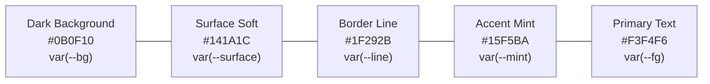

# Identidade Visual e Diretrizes de Marca — ToolsOnDesk
## Missão 07: Sistema de Design, Iconografia e Tipografia Oficial

---

## 1. Visão e Conceito da Marca

**ToolsOnDesk** representa a convergência entre ferramentas profissionais de alta precisão e a conveniência de um estúdio multimídia completo ao alcance imediato na área de trabalho do criador.

### 1.1 Pilares da Identidade
1. **Desktop-First & Autonomia:** Utilitários de elite (conversão, poster, PDF, áudio, vídeo, motion design) operando de forma offline e nativa na máquina local.
2. **Clareza para Não-Programadores:** Interfaces generativas visuais que traduzem tarefas complexas de computação gráfica e renderização em fluxos naturais de 1 clique.
3. **Precisão & Estética Contemporânea:** Silhuetas geométricas, contraste marcante com fundo escuro e acento verde-menta de alta energia.

---

## 2. Logotipo e Símbolo Oficial

O símbolo foi desenhado com base em uma grade vetorial de precisão de 512x512 pixels:

```
┌──────────────────────────────────────────────┐
│  [ t/d ]  ToolsOnDesk                        │
│           CREATIVE & MEDIA STUDIO            │
└──────────────────────────────────────────────┘
```

### 2.1 Elementos Construtivos do Símbolo
- **Workstation Desk Plane:** Estrutura isométrica que remete a uma mesa de trabalho física e digital.
- **Interlocking Workstation Glyph:** As formas primárias combinam a trave horizontal do **T** com a curva do workspace **D**, simbolizando ferramentas integradas diretamente sobre a mesa de trabalho.
- **Prisma Criativo Central:** Faceta geométrica em verde-menta luminoso (`#36FFCE` / `#15F5BA`) orientada para o futuro e inovação com IA.

### 2.2 Variações Produzidas

| Versão | Arquivo Fonte | Aplicação |
|---|---|---|
| **Símbolo Principal (Dark)** | [`public/toolsondesk-icon.svg`](file:///home/mateusarcedev/projetos/arce-tools/public/toolsondesk-icon.svg) | Ícone de aplicativo, barra de título, dock e instalador Windows. |
| **Logotipo Horizontal Completo** | [`public/logo-toolsondesk.svg`](file:///home/mateusarcedev/projetos/arce-tools/public/logo-toolsondesk.svg) | Telas de abertura, relatórios, cabeçalhos e documentação oficial. |
| **Versão Fundo Claro** | [`public/symbol-toolsondesk-light.svg`](file:///home/mateusarcedev/projetos/arce-tools/public/symbol-toolsondesk-light.svg) | Documentos exportados, impressões em papel e modo claro. |
| **Versão Monocromática** | [`public/symbol-toolsondesk-mono.svg`](file:///home/mateusarcedev/projetos/arce-tools/public/symbol-toolsondesk-mono.svg) | Selos em preto e branco, gravuras, favicons minimalistas. |
| **Pacote Multi-Resolução Windows** | [`src-tauri/icons/icon.ico`](file:///home/mateusarcedev/projetos/arce-tools/src-tauri/icons/icon.ico) | Binário do Windows 11 (16x16, 24x24, 32x32, 48x48, 64x64, 128x128, 256x256). |

---

## 3. Paleta Cromática e Tokens

Todas as cores respeitam rigorosamente as variáveis CSS do design system em `src/styles/tokens.css`:



| Token CSS | Hex Dark | Hex Light | Função no Sistema |
|---|---|---|---|
| `--bg` | `#0B0F10` | `#F8FAFC` | Fundo principal da aplicação e janelas frameless. |
| `--surface` | `#141A1C` | `#FFFFFF` | Cartões de módulos, modais e barra lateral. |
| `--surface-2` | `#1A2326` | `#F1F5F9` | Inputs, áreas de drop e gavetas retráteis. |
| `--line` | `#1F292B` | `#E2E8F0` | Divisórias e bordas estruturais de 1px. |
| `--mint` | `#15F5BA` | `#076B39` | Acento principal, foco visual, progresso e CTAs. |
| `--fg` | `#F3F4F6` | `#0F172A` | Títulos, textos primários e botões principais. |
| `--fg-dim` | `#9CA3AF` | `#64748B` | Subtítulos, descrições secundárias e badges. |
| `--mono` | `'Geist Mono'` | `'Geist Mono'` | Timecodes, hashes, caminhos de arquivo, atalhos. |

---

## 4. Tipografia Oficial

O aplicativo utiliza exclusivamente as fontes locais de alta fidelidade:
- **`Geist`**: Títulos, menus, botões, modais e textos de interface.
- **`Geist Mono`**: Métricas técnicas, atalhos de teclado (`Ctrl+K`, `Ctrl+J`, `Ctrl+6`), dimensões de mídia e códigos de erro.
- Ambas as fontes são empacotadas em formato WOFF2 localmente em `/public/fonts/`, dispensando conexões com CDNs externas.

---

## 5. Tom de Voz e Comunicação

- **Direto e Descomplicado:** Evita jargões de linha de comando ou programação na interface principal. O usuário "Gera um Motion", "Converte um Áudio" ou "Une PDFs".
- **Transparente e Confiável:** Informa exatamente o que está acontecendo localmente e na nuvem, sem promessas fictícias ou telas falsas de progresso.
- **Segurança Proativa:** Orienta o usuário sobre caminhos de backup, integridade de dados e proteção de credenciais.
