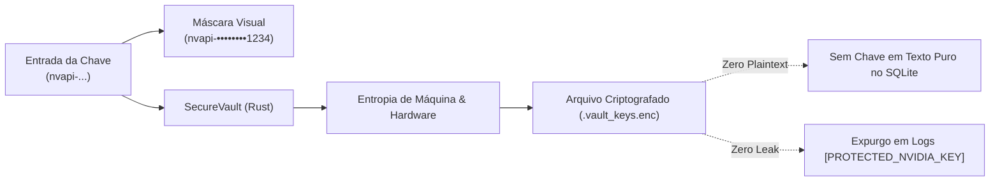

# Creative Security — Diretrizes de Proteção e Privacidade

Especificação das camadas de defesa e segurança implementadas no **Arce Creative Studio**.

---

## 1. Proteção de Credenciais e Vault Seguro



1. **Sem Texto Puro no Banco de Dados:** A chave NVIDIA jamais é inserida nas tabelas do SQLite (`preferences`, `creative_projects`, etc.).
2. **Criptografia por Máquina:** Os dados de autenticação são criptografados através de cifras com chave derivada do identificador de máquina e salt da aplicação.
3. **Expurgo Automático de Logs:** O sanitizador de erros substitui preventivamente qualquer padrão que corresponda a chaves `nvapi-` ou cabeçalhos de autenticação por `[PROTECTED_NVIDIA_KEY]`.

---

## 2. Isolamento de Espaço de Trabalho e Defesa contra Travessia de Diretório (Path Traversal)

1. **Prevenção de Path Traversal:** Ao gravar imagens ou vídeos gerados, o backend valida que o caminho de destino reside estritamente dentro do diretório de assets autorizado da aplicação:
   ```rust
   if !target_path.starts_with(output_dir) {
       return Err(AppError::InvalidInput("Violação de caminho de segurança ao salvar imagem".into()));
   }
   ```
2. **Defesa contra Execução de Código Arbitrário (Open Intelligent UI):**
   - Toda saída produzida por modelos LLM é tratada como conteúdo não-confiável (*untrusted*).
   - Não há uso de `dangerouslySetInnerHTML`, `eval()` ou injeção de tags `<script>` na interface. As árvores de componentes são construídas exclusivamente por dados estritamente tipados e validados contra esquemas JSON.
3. **Supervisão de Processos e Cancelamento Imediato:**
   - Todo subprocesso externo (FFmpeg ou OpenCode) é criado com `CREATE_NO_WINDOW = 0x08000000` e monitora um `CancellationToken` atômico. Se o usuário cancelar a operação, `child.kill()` é acionado e arquivos temporários parciais são expurgados do disco.
