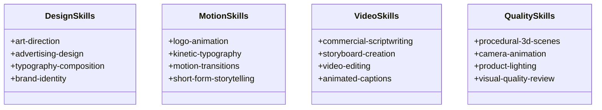

# Biblioteca de Skills Criativas — Catálogo e Especificação — ToolsOnDesk (ex-Arce Tools)

Este documento detalha as 16 skills nativas integradas ao **SkillManager** do **ToolsOnDesk** (`src-tauri/src/engines/skills.rs`), projetadas segundo o padrão universal de agentes `SKILL.md`.

> [!NOTE]
> **Evolução de Exportação (Missão 07):** A partir da Missão 07, a exportação de skills para o sistema de arquivos local é roteada dinamicamente via `PathManager::skills_dir()`, residindo em `%LOCALAPPDATA%\ToolsOnDesk\skills\`.

---

## 1. Padrão SKILL.md

Cada skill contém metadados declarativos em YAML seguidos de instruções técnicas, diretrizes estéticas e critérios de qualidade:

```yaml
---
name: logo-animation
display_name: "Animação de Logotipo"
description: "Entradas fluidas, escalas elásticas (spring), rotações cinemáticas e saídas elegantes."
category: motion
version: 1.0.0
tools: ["motion-engine", "spring-physics"]
limitations: "Ideal para durações entre 3 e 6 segundos."
license: MIT
---
```

---

## 2. Catálogo das 16 Skills Nativas



### Categoria 1: Design Gráfico
1. **`art-direction`:** Harmonização de paletas de cores (regra 60-30-10), contraste visual WCAG AA e atmosfera estética.
2. **`advertising-design`:** Conversão para anúncios digitais, ganchos visuais e botões de chamada para ação (CTA).
3. **`typography-composition`:** Emparelhamento tipográfico estrito (Geist e Geist Mono), respiros de margem e hierarquia de títulos.
4. **`brand-identity`:** Zonas de proteção de marcas, integridade de proporções de logotipos e paletas institucionais.

### Categoria 2: Motion Design
5. **`logo-animation`:** Escala com amortecimento elástico (spring damping 0.7), sweeps de luminosidade em 45º e idle float.
6. **`kinetic-typography`:** Efeitos de subida de texto (slide-up fade em 400ms), preços saltando e cascata de palavras.
7. **`motion-transitions`:** Wipes direcionais suaves, zoom-in punch a 120% e dissoluções harmônicas entre cenas.
8. **`short-form-storytelling`:** Estrutura para Reels e TikTok em 3 atos: Gancho (0-3s), Entrega de Valor (3-11s) e Chamada Final (11-15s).

### Categoria 3: Vídeo & Roteiro
9. **`commercial-scriptwriting`:** Roteiros estruturados no método AIDA (Atenção, Interesse, Desejo, Ação) para produtos e serviços.
10. **`storyboard-creation`:** Planejamento cena a cena com miniaturas visuais, anotações de câmera e cronograma em milissegundos.
11. **`video-editing`:** Sincronização de cortes com batidas musicais, volume ducking (-18dB durante narrações) e mixagem.
12. **`animated-captions`:** Legendas dinâmicas de alto contraste, borda de 4px e realce em palavras-chave.

### Categoria 4: 3D & Qualidade
13. **`procedural-3d-scenes`:** Camadas de paralaxe tridimensional (fundo 0.2x, objeto 1.0x, partículas 1.5x) e iluminação especular.
14. **`camera-animation`:** Efeito Ken Burns contínuo (zoom 1.00 para 1.08), pans descendentes e transições gravitacionais.
15. **`product-lighting`:** Iluminação de três pontos (Key Light 5500K, Fill Light 40% e Rim Light menta de recorte).
16. **`visual-quality-review`:** Auditoria prévia de renderização: limites de safe margins, integridade de codecs e verificação de áudio.

---

## 3. Gestão e Exportação no Disco

O `SkillManager` mantém as skills carregadas sob demanda para economia de memória e disponibiliza o método `export_skills_to_disk`, que grava a estrutura no diretório `%APPDATA%\Arce Tools\skills\` caso o usuário deseje utilizá-las no OpenCode ou outros agentes autônomos.
