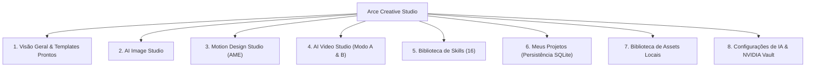

# ToolsOnDesk Creative Studio (ex-Arce Creative Studio) — Visão Geral e Guia de Uso

O **ToolsOnDesk Creative Studio** é o módulo criativo com inteligência artificial integrado ao **ToolsOnDesk** (Missões 06 e 07). Foi projetado especificamente para que criadores de conteúdo, profissionais de marketing, empreendedores e designers produzam peças visuais, motion graphics, vídeos comerciais e roteiros persuasivos sem a necessidade de conhecimento prévio em programação ou ferramentas de linha de comando.

> [!NOTE]
> **Evolução de Marca e Infraestrutura (Missão 07):** Originalmente lançado como *Arce Creative Studio*, o estúdio foi renomeado para **ToolsOnDesk Creative Studio**. Seus dados de persistência foram transferidos com segurança para `%LOCALAPPDATA%\ToolsOnDesk\projects\` e `%LOCALAPPDATA%\ToolsOnDesk\assets\`, e suas chaves de API da NVIDIA foram promovidas para proteção com **Windows DPAPI**.

---

## 1. Visão do Produto e Filosofia

O fluxo de trabalho foi modelado no princípio:

$$\text{Descrever Ideia} \longrightarrow \text{Escolher Estilo} \longrightarrow \text{Gerar} \longrightarrow \text{Pré-visualizar (60 FPS)} \longrightarrow \text{Ajustar Parâmetros} \longrightarrow \text{Exportar}$$

Toda a complexidade técnica subjacente (execução de modelos na nuvem NVIDIA NIM, física elástica *spring* de animações, interpolação de frames, renderização local com FFmpeg e isolamento em sandbox) é abstraída através de uma interface gráfica escura e responsiva com acento menta (`#15F5BA`).

---

## 2. Estrutura dos Módulos

### 2.1 Visão Geral
- **Hero Banner:** Status do provedor NVIDIA e atalhos de alta prioridade.
- **Templates Criativos Prontos:** 10 modelos pré-configurados abrangendo e-commerce, anúncios, Reels, thumbnails e logotipos.
- **Projetos Recentes:** Acesso imediato às composições em andamento.

### 2.2 AI Image Studio
- **Campo de Prompt Natural:** Suporte a descrições ricas com opção de *Aprimorar com IA*.
- **9 Estilos Visuais Embutidos:** Publicitário, Fotográfico, Cinematográfico, Minimalista, Editorial, Ilustração, 3D, Produto e Social Media.
- **Proporções Flexíveis:** 1:1 (Quadrado), 16:9 (Horizontal) e 9:16 (Vertical).
- **Galeria Integrada:** Pré-visualização com 1 clique para transferir diretamente para o Motion Studio como camada de cena.

### 2.3 Motion Design Studio
- **Arce Motion Engine (AME):** Motor próprio em Canvas/SVG/FFmpeg rodando a 60 FPS no player da interface.
- **Composições Multicamada:** Camadas de texto, formas, selos de preço e imagens.
- **Ajustador de Parâmetros:** Controle visual em tempo real de textos, tamanhos, durações e cores sem tocar em código.
- **Renderização MP4 Direta:** Processamento em segundo plano via FFmpeg nativo sem custo de licença.
- **Interoperabilidade:** Botão para exportar o projeto como código TypeScript compatível com Remotion (`.tsx`).

### 2.4 AI Video Studio
- **Modo B (Vídeo Composto - Local / 100% Offline):** Storyboard com aprovação cena a cena, trilhas de áudio, legendas automáticas e montagem via FFmpeg.
- **Modo A (Vídeo Generativo - Nuvem):** Conexão com modelos generativos da NVIDIA (ex: Cosmos, SVD) com detecção transparente de cotas e erros amigáveis.

### 2.5 Biblioteca de Skills
- 16 skills pré-instaladas seguindo o padrão OpenCode `SKILL.md`.
- Busca instantânea, filtros por categoria (Design, Motion, Vídeo, 3D & Qualidade) e modal com instruções completas.

---

## 3. Assistente de Briefing Criativo (Open Intelligent UI)

Inspirado nas diretrizes do Open Intelligent UI, o estúdio disponibiliza um assistente interativo em 3 etapas:
1. **Objetivo & Nicho:** Define a finalidade (ex: promoção de produto, branding) e o segmento de mercado.
2. **Estilo & Formato:** Seleção guiada da proporção e do tom (energético, elegante, cinematográfico).
3. **Oferta & Síntese:** Formulação da proposta de valor, gerando automaticamente o prompt estruturado e ativando as skills recomendadas.
