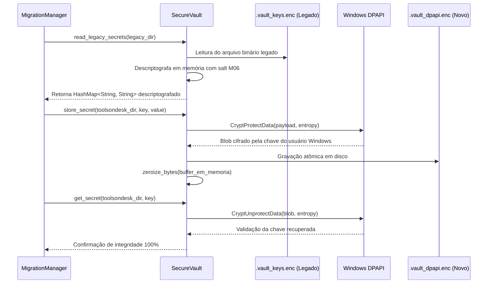

# Migração Segura de Credenciais (Windows DPAPI) — ToolsOnDesk
## Missão 07: Auditoria, Evolução Criptográfica e Migração do NVIDIA SecureVault

---

## 1. Auditoria da Implementação Legada (Missão 06)

Na Missão 06, o cofre de credenciais (`.vault_keys.enc`) foi implementado com um cifrador de fluxo XOR baseado em contador SHA-256. A derivação da chave de criptografia utilizava variáveis de ambiente do sistema (`COMPUTERNAME`, `USERNAME`, `USERPROFILE`) combinadas a um salt estático.

### Vulnerabilidades Identificadas na Auditoria:
1. **Falta de Segredo do Sistema Operacional:** Identificadores como nome do computador e usuário são metadados públicos e previsíveis no Windows. Qualquer processo executando na máquina poderia reconstruir a mesma chave sem necessidade de privilégios especiais.
2. **Ausência de Vinculação com o Logon do Usuário:** O cofre antigo não utilizava a camada de proteção de dados do Windows (LSA / DPAPI), permitindo potencial leitura offline caso o arquivo fosse copiado para outra partição ou máquina.

---

## 2. Nova Arquitetura Criptográfica: Windows DPAPI

Para o **ToolsOnDesk**, a segurança de credenciais foi completamente elevada adotando a **Windows Data Protection API (DPAPI)** nativa do Windows:

```
┌─────────────────────────────────────────────────────────────┐
│                    PAYLOAD DA CHAVE NVIDIA                  │
│             {"nvidia_api_key": "nvapi-..."}                 │
└──────────────────────────────┬──────────────────────────────┘
                               │
                               ▼
┌─────────────────────────────────────────────────────────────┐
│               CryptProtectData (Crypt32.dll)                │
│                                                             │
│  - Master Key do Usuário do Windows (LSA Logon Session)     │
│  - Entropia Adicional: b"TOOLSONDESK_DPAPI_ENTROPY_v1"      │
│  - Flag: CRYPTPROTECT_UI_FORBIDDEN (0x1)                    │
└──────────────────────────────┬──────────────────────────────┘
                               │
                               ▼
┌─────────────────────────────────────────────────────────────┐
│              .vault_dpapi.enc (%LOCALAPPDATA%)              │
│       Arquivo Criptografado Ilegível sem Logon Válido       │
└─────────────────────────────────────────────────────────────┘
```

### 2.1 Garantias de Segurança da DPAPI:
- **Vinculação com o Usuário:** A chave mestra da DPAPI deriva das credenciais do usuário autenticado no Windows 11. Nenhum outro usuário ou administrador da máquina consegue descriptografar o payload.
- **Entropia Adicional Aplicada:** Um vetor de bytes exclusivo do aplicativo (`TOOLSONDESK_DPAPI_ENTROPY_v1`) é combinado na chamada `CryptProtectData`, impedindo que outros aplicativos chamem DPAPI genericamente para ler o mesmo arquivo.
- **Sobrescrita Volátil de Buffers (`zeroize_bytes`):** Após a serialização ou deserialização das chaves em memória, os buffers são sobrescritos com zeros voláteis (`std::ptr::write_volatile`), prevenindo vazamentos em dumps de memória RAM.

---

## 3. Fluxo de Migração Transacional de Credenciais

O processo de migração executado pelo [`MigrationManager`](file:///home/mateusarcedev/projetos/arce-tools/src-tauri/src/storage/migration.rs) e pelo [`SecureVault`](file:///home/mateusarcedev/projetos/arce-tools/src-tauri/src/utils/vault.rs) segue 8 passos rigorosos:



---

## 4. Tratamento de Falhas e Sanitização de Logs

1. **Se a Chave Antiga Estiver Inacessível ou Corrompida:**
   - O sistema **NUNCA** inventa uma credencial fictícia.
   - O arquivo legado é preservado intacto.
   - O status é reportado como `credentials_migrated: false`.
   - A interface exibe aviso amigável convidando o usuário a re-inserir sua chave nas configurações de IA do ToolsOnDesk.
2. **Sanitização Contínua em Logs:**
   - A regex `NVIDIA_KEY_REGEX` continua ativa no pipeline global de logs, convertendo qualquer ocorrência `nvapi-...` em `[PROTECTED_NVIDIA_KEY]`.
   - Chaves nunca são registradas em texto puro no SQLite, logs ou manifestos de backup.
