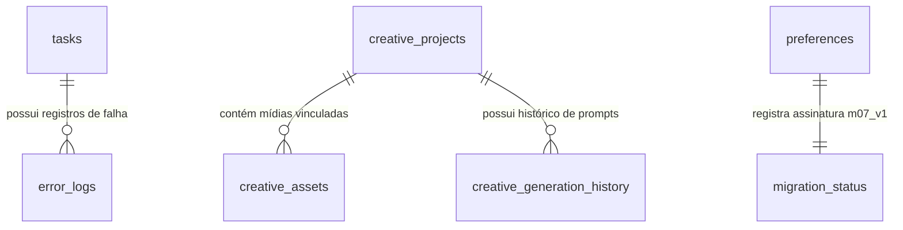

# Migração de Dados SQLite e Reconciliação de Caminhos — ToolsOnDesk
## Missão 07: Especificação Técnica do Mecanismo de Migração

---

## 1. Visão Geral da Arquitetura de Dados

A persistência de dados do aplicativo utiliza **SQLite 3** em modo WAL (`journal_mode = WAL`), garantindo alta concorrência entre threads de leitura e escrita sem bloqueios de interface.

Na transição de identidade:
- **Origem (Arce Tools):** `%LOCALAPPDATA%\com.mateusarcedev.arce-tools\arce_tools.db`
- **Destino (ToolsOnDesk):** `%LOCALAPPDATA%\ToolsOnDesk\database\toolsondesk.db`

---

## 2. Tratamento Transacional do SQLite WAL via Online Backup API

Copiar um arquivo `.db` simplesmente via cópia de arquivo do sistema operacional enquanto o aplicativo ou processos anteriores mantêm arquivos de log `-wal` e `-shm` ativos pode gerar leituras inconsistentes ou corrompidas (*torn database*).

Para mitigar esse risco de forma 100% segura, o [`MigrationManager`](file:///home/mateusarcedev/projetos/arce-tools/src-tauri/src/storage/migration.rs) utiliza a **SQLite Online Backup API** nativa (`rusqlite::backup::Backup`):

```rust
let src_conn = Connection::open(&legacy_db)?;
let mut dst_conn = Connection::open(&backup_db_file)?;
let backup = rusqlite::backup::Backup::new(&src_conn, &mut dst_conn)?;
backup.run_to_completion(100, std::time::Duration::from_millis(10), None)?;
drop(backup);
drop(src_conn);
drop(dst_conn);
```

### Vantagens Técnicas:
1. **Consistência Atômica:** O SQLite realiza o checkpoint interno das páginas do WAL diretamente para o banco de destino da cópia.
2. **Não-Bloqueante:** Outras leituras não são interrompidas.
3. **Validação SHA-256:** O snapshot gerado é submetido a cálculo de hash criptográfico gravado no `manifest.json`.

---

## 3. As 7 Tabelas Relacionais e Garantia de Idempotência

Todas as tabelas são transferidas utilizando a cláusula `INSERT OR IGNORE INTO {table} SELECT * FROM legacy.{table}` através de anexo de banco de dados (`ATTACH DATABASE`), permitindo transferência em altíssima velocidade em uma única transação atômica:



| Tabela | Chave Primária | Estratégia de Migração |
|---|---|---|
| `tasks` | `id TEXT` | `INSERT OR IGNORE`: Preserva todas as tarefas históricas, progresso e caminhos. |
| `history` | `id TEXT` | `INSERT OR IGNORE`: Preserva o feed de atividades da UI. |
| `preferences` | `key TEXT` | `INSERT OR IGNORE`: Preserva preferências do usuário (tema, limites de concorrência). |
| `error_logs` | `id TEXT` | `INSERT OR IGNORE`: Preserva todos os 6 índices de auditoria e status de resolução. |
| `creative_projects` | `id TEXT` | `INSERT OR IGNORE`: Preserva título, proporções, duração, prompt, style, model, skills e JSON de cenas. |
| `creative_assets` | `id TEXT` | `INSERT OR IGNORE`: Preserva metadados de imagens, áudios e vídeos importados/gerados. |
| `creative_generation_history` | `id TEXT` | `INSERT OR IGNORE`: Preserva sementes, prompts e durações de inferência. |

---

## 4. Algoritmo de Reconciliação de Caminhos

Após a cópia das tabelas, o `MigrationManager` executa instruções parametrizadas de sanitização e atualização de caminhos internos:

1. **Binários Gerenciados:**
   - De: `%LOCALAPPDATA%\ArceTools\binaries`
   - Para: `%LOCALAPPDATA%\ToolsOnDesk\binaries`
2. **Workspace de IA & OpenCode:**
   - De: `%LOCALAPPDATA%\ArceTools\workspace`
   - Para: `%LOCALAPPDATA%\ToolsOnDesk\workspace`
3. **Caminhos Externos do Usuário:**
   - Referências a pastas arbitrárias do usuário (ex: `C:\Users\...\Downloads\...`, `D:\Projetos\...`) **NUNCA são alteradas ou movidas**. Permanecem apontando para o arquivo original no disco.

---

## 5. Validação de Integridade e Protocolo de Rollback

Antes de aplicar a assinatura de migração (`COMMIT`), o sistema executa:
1. `PRAGMA integrity_check`: Valida a estrutura B-Tree e índices de todas as páginas.
2. `PRAGMA foreign_key_check`: Valida chaves estrangeiras entre projetos e assets.
3. **Conferência de Contagem:** Compara o número de registros inseridos com a contagem do banco de origem.

Se qualquer verificação falhar:
- A transação é abortada.
- O banco de destino defeituoso é isolado.
- Os dados antigos em `%LOCALAPPDATA%\com.mateusarcedev.arce-tools` **permanecem intactos**.
- O estado é marcado como `RECOVERY_REQUIRED` e o usuário é notificado.
