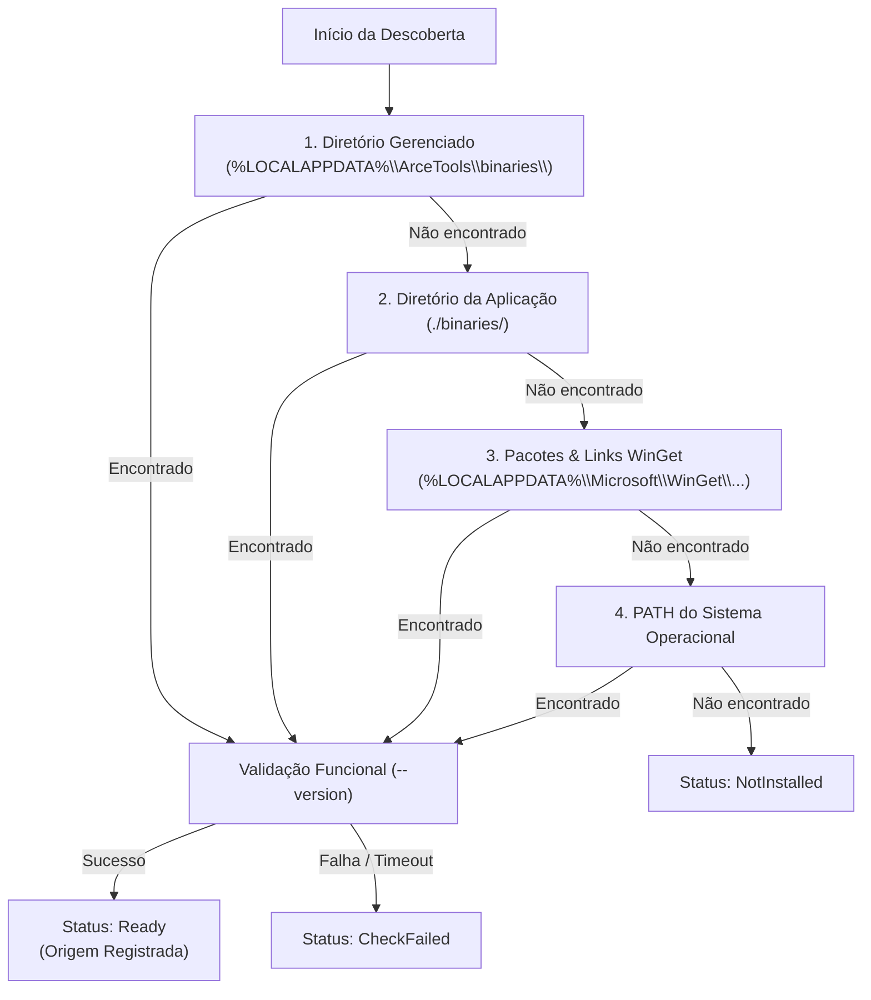

# ARCE TOOLS — Gerenciador de Dependências (`DependencyManager`)

O **DependencyManager** é o subsistema nativo em Rust do Arce Tools responsável pela descoberta, verificação de integridade, instalação assistida, atualização atômica e remoção segura de executáveis e bibliotecas externas necessárias para módulos específicos da aplicação.

---

## 1. Arquitetura e Princípios

1. **Zero Configuração Manual**: O usuário final nunca precisa abrir terminal, PowerShell, configurar variáveis `PATH`, instalar Node.js/Python ou compilar binários.
2. **Instalação Isolada por Usuário**: Os binários gerenciados são instalados exclusivamente no diretório `%LOCALAPPDATA%\ArceTools\binaries\` do usuário atual. Não são solicitadas permissões de administrador (UAC) e o sistema global não é alterado.
3. **Desacoplamento Modular**: Ferramentas 100% nativas em Rust (Imagens com Lanczos3, Poster Studio com geração vetorial de PDF 1.4 e fusão/divisão/compressão do Document Engine com lopdf e docx-rs) continuam operacionais mesmo que nenhum executável externo esteja presente.
4. **Verificação Funcional Obrigatória**: Um binário nunca é considerado pronto apenas pela existência de um arquivo com seu nome no disco. O motor executa comandos controlados (`-version`, `--version`) com timeouts e validação de código de saída.

---

## 2. Estratégia de Descoberta (Ordem de Resolução)

Quando uma operação solicita um utilitário (como `ffmpeg`, `ffprobe` ou `yt-dlp`), a busca segue a seguinte prioridade estrita:

---

## 3. Componentes Gerenciados

### 3.1 FFmpeg & ffprobe
- **Módulos Dependentes**: Áudio (conversão, compressão, corte, normalização EBU R128), Vídeo (conversão, compressão CRF, extração de áudio/frames).
- **Origem Oficial**: [Gyan.dev](https://www.gyan.dev/ffmpeg/builds/ffmpeg-release-essentials.zip) (Distribuidor oficial recomendado pelo projeto FFmpeg).
- **Tamanho**: ~35 MB compactado / ~80 MB descompactado.
- **Extração Segura**: Leitura de arquivo `.zip` com verificação de caminho relativo (`entry.enclosed_name()`). Qualquer tentativa de travessia de diretório (*Zip Slip*) causa aborto imediato da extração.
- **Validação**: Execução isolada de `ffmpeg.exe -version` e `ffprobe.exe -version` em pasta de staging antes de mover para a pasta definitiva.

### 3.2 yt-dlp
- **Módulo Dependente**: Downloads multiplataforma (YouTube, TikTok, Instagram, Reels, Facebook, etc.).
- **Origem Oficial**: [GitHub Releases oficial do yt-dlp](https://github.com/yt-dlp/yt-dlp/releases/latest/download/yt-dlp.exe).
- **Tamanho**: ~18 MB (executável standalone).
- **Substituição Atômica & Rollback**:
  1. Download para arquivo temporário `yt-dlp.tmp`.
  2. Validação funcional de `yt-dlp.tmp --version`.
  3. Renomeação do binário anterior para `yt-dlp.exe.old`.
  4. Cópia do novo binário para `yt-dlp.exe`.
  5. Caso ocorra erro durante o swap, restauração imediata do `.old`.
  6. Remoção de arquivos temporários.

### 3.3 LibreOffice (Opcional)
- **Módulo Dependente**: Conversão Word (.docx/.doc) para PDF no Document Engine.
- **Natureza**: 100% opcional. Não impede o uso de nenhuma outra ferramenta.
- **Descoberta**:
  1. Caminho personalizado configurado pelo usuário no SQLite (`custom_libreoffice_path`).
  2. Instalações padrão em `C:\Program Files\LibreOffice\program\soffice.exe`.
  3. `soffice` no `PATH`.
- **Ações Disponíveis**: "Detectar novamente", "Instalar (comando winget)", "Configurar caminho" e "Ignorar".

---

## 4. Códigos de Erro Estruturados

Falhas de dependência são tratadas pela Central de Erros e Diagnósticos com os códigos:

| Código | Descrição |
|---|---|
| `DEPENDENCY_NOT_FOUND` | Binário solicitado não foi localizado em nenhum dos 4 níveis de busca. |
| `DEPENDENCY_DOWNLOAD_FAILED` | Erro de rede ou HTTP durante o download do pacote. |
| `DEPENDENCY_HASH_MISMATCH` | O hash SHA-256 do arquivo baixado difere do checksum esperado. |
| `DEPENDENCY_INSTALL_FAILED` | Falha na extração ou gravação no diretório de destino. |
| `DEPENDENCY_VERSION_UNSUPPORTED`| A versão do executável encontrada é incompatível com os comandos da aplicação. |
| `DEPENDENCY_PERMISSION_DENIED` | Diretório de destino protegido contra gravação pelo SO. |
| `DEPENDENCY_VALIDATION_FAILED` | O executável baixado falhou no teste funcional (`--version`). |
| `DEPENDENCY_UPDATE_FAILED` | Falha na atualização atômica de um binário já instalado. |
| `DEPENDENCY_ROLLBACK_FAILED` | Falha ao restaurar a versão anterior durante um rollback. |

---

## 5. Remoção Segura

O comando `remove_managed_dependency(name)`:
- Exclui estritamente arquivos dentro de `%LOCALAPPDATA%\ArceTools\binaries\`.
- Nunca remove ou altera binários globais instalados via WinGet, instaladores manuais ou presentes no `PATH`.
- Garante que o usuário mantenha controle total sobre o espaço em disco.
