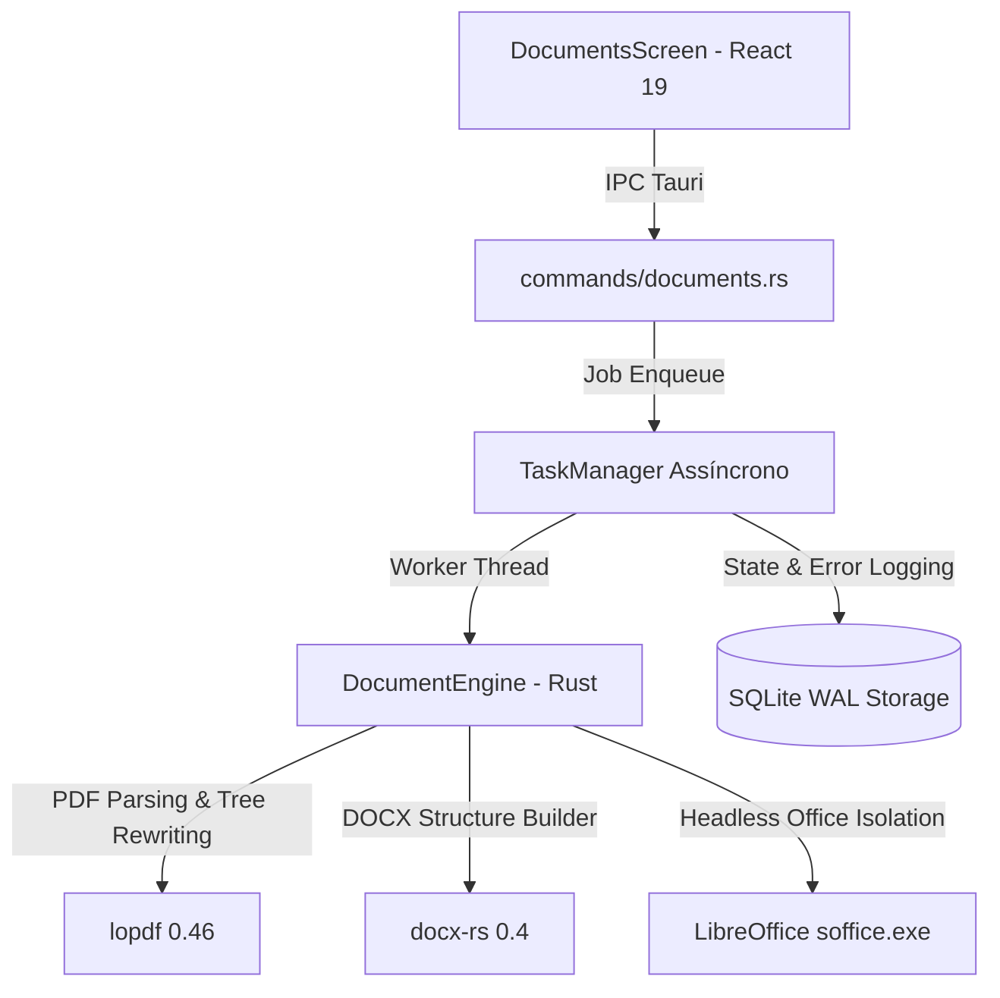

# Arquitetura do Document Engine — Arce Tools

O **Document Engine** do Arce Tools é o subsistema nativo responsável pelo processamento de documentos portáteis (PDF), conversão entre formatos de escritório (DOCX/DOC/ODT) e manipulação estrutural de páginas.

O motor adota uma abordagem estritamente **offline-first**, garantindo privacidade absoluta dos dados do usuário, sem qualquer dependência de nuvem, telemetria oculta ou serviços de terceiros pagos.

---

## 1. Visão Geral dos Componentes

O Document Engine é estruturado em Rust nativo com interoperação segura via Tauri 2:

---

## 2. Detalhamento dos Módulos

### 2.1 PDF Inspector (`inspect_pdf`)
- **Objetivo**: Extrai metadados completos e amostras de texto para informar a interface antes do início do processamento.
- **Campos inspecionados**:
  - Contagem exata de páginas (`page_count`).
  - Tamanho em disco e formato legível (`file_size_formatted`).
  - Status de proteção por senha / criptografia (`is_encrypted`).
  - Detecção de texto selecionável (`has_selectable_text`).
  - Metadados do cabeçalho (Título, Autor, Criador).
  - Dimensões da folha em pontos tipográficos (`MediaBox`) e rotação embutida (`Rotate`).
  - Orientação visual da primeira página (`Retrato` vs `Paisagem`).
- **Resiliência**: Tratamento polimórfico de dimensões no PDF (suporta `Object::Real` e `Object::Integer` para MediaBox via helper `obj_to_f64`).

### 2.2 PDF Merge Engine (`merge_pdfs`)
- **Objetivo**: Une múltiplos PDFs em um único arquivo de saída respeitando a ordem definida pelo usuário.
- **Algoritmo de Renumeração de Objetos**:
  - PDFs contêm tabelas de referências indiretas (`(u32, u16)`). Ao concatenar dois documentos, IDs de objetos colidem diretamente.
  - O motor cria um novo documento `lopdf::Document::with_version("1.5")` e um objeto pai `/Pages`.
  - Para cada PDF fonte:
    - Extrai todas as páginas do dicionário raiz `/Pages`.
    - Realiza mapeamento `doc.renumber_objects_with` para atribuir novos identificadores livres sem colisão.
    - Anexa as páginas na árvore de Kids do novo catálogo.
  - Finaliza compactando a árvore resultante com `prune_objects` e `compress`.

### 2.3 PDF Split Engine (`split_pdf`)
- **Modos de Operação**:
  1. `all`: Extrai cada página em um PDF independente (`documento_pag_001.pdf`).
  2. `ranges`: Suporta expressões flexíveis de intervalos (ex: `1-3, 5, 8-10`), com validação sintática e desduplicação de páginas.
  3. `every_n`: Agrupa páginas em lotes de tamanho $N$ (ex: fatias de 2 em 2 páginas).
  4. `export_single`: Opção para consolidar as páginas selecionadas por intervalo em um único arquivo de saída.

### 2.4 PDF Organizer (`organize_pdf`)
- **Objetivo**: Permite reordenar a sequência de páginas, rotacionar páginas individuais em incrementos de 90° e excluir páginas indesejadas.
- **Regra Fundamental**: **O arquivo original nunca é sobrescrito**. Um novo PDF resultante é salvo no diretório de exportações configurado pelo usuário.
- **Mapeamento**:
  - Cada ação de página define `original_page` e `rotation_deg`.
  - A rotação final é computada como `(rot_atual + rot_adicional) % 360`.

### 2.5 PDF Compression Engine (`compress_pdf`)
- **Níveis de Otimização**:
  - `lossless`: Limpeza estrutural de objetos não referenciados (`prune_objects`) e recompressão de todos os streams de dados via algoritmo Deflate/FlateDecode (`compress_stream`). Nenhuma imagem tem seus pixels alterados.
  - `recommended`: Otimização balanceada de dicionários, remoção de metadados XML redundantes e descarte de dados temporários de impressão.
  - `extreme`: Poda agressiva de anotações auxiliares, miniaturas embutidas (`Thumb`) e streams residuais.
- **Métricas**: Calcula o tamanho antes e depois, reportando no resultado o percentual exato de economia obtido no disco.

### 2.6 Word to PDF Converter (`convert_word_to_pdf`)
- **Motor**: LibreOffice em modo headless (`soffice.exe`).
- **Isolamento de Perfil**:
  - Executa com `-env:UserInstallation=file:///<temp_profile_dir>`. Isso garante que a conversão funcione perfeitamente mesmo se o usuário já estiver com outra janela do LibreOffice aberta, evitando conflitos de lock no `registrymodifications.xcu`.
- **Segurança**:
  - Desativação de macros e interfaces de rede.
  - Timeout automático de 120 segundos para prevenir loops infinitos em documentos corrompidos.
  - Sanitização de caminhos no Windows com prefixos normatizados.

### 2.7 PDF to Word Converter (`convert_pdf_to_docx`)
- **Motor**: Extração de texto via `lopdf` + montagem estruturada via `docx-rs`.
- **Reconstrução Documental**:
  - Extrai blocos de texto por página, identifica quebras de parágrafo e gera elementos `<w:p>` e `<w:r>` nativos do padrão OpenXML (DOCX).
  - Detecção de documentos escaneados: Se o PDF for baseado inteiramente em imagens rasterizadas e não possuir texto selecionável, o motor aborta com mensagem amigável instruindo que OCR óptico é necessário para vetorizar a digitalização.

---

## 3. Integração com o TaskManager

Todas as operações de escrita e conversão de documentos são enfileiradas como tarefas gerenciadas:
- Controle de cancelamento cooperativo.
- Atualização atômica de progresso percentual (0.0 a 1.0).
- Registro automático de histórico e erros no SQLite local.
