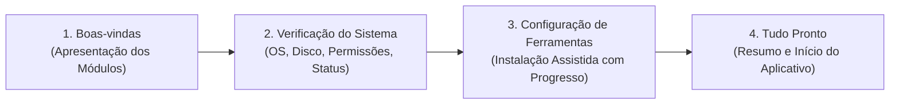

# ARCE TOOLS — Experiência de Primeiro Uso (Setup Center)

A **Central de Configuração Inicial (Setup Center)** do Arce Tools é um assistente interativo e elegante que guia o usuário na primeira abertura do aplicativo ou quando dependências essenciais estiverem ausentes.

---

## 1. Gatilhos de Ativação e Persistência

- **Primeira Inicialização**: Detectada pela ausência da chave `first_run_status` na tabela `preferences` do SQLite local.
- **Opção de Dispensar**: O usuário pode clicar em **"Configurar depois"**, o que salva `first_run_status = "dismissed"`. O assistente não é exibido novamente de forma intrusiva em inicializações posteriores.
- **Reabertura pelo Usuário**:
  1. Na tela de **Configurações $\rightarrow$ Ferramentas e Dependências**, através do botão **"Reabrir Assistente de Configuração"**.
  2. Pela **Paleta Universal de Comandos (`Ctrl+K`)**, digitando `"setup"` ou `"configurar ferramentas"`.

---

## 2. As Quatro Etapas do Assistente

### 2.1 Etapa 1: Boas-vindas
- Título: *"Vamos preparar seu Arce Tools"*.
- Descrição clara explicando que os componentes necessários serão checados para funcionamento adequado.
- Grade visual com os 6 principais módulos:
  - **Downloads** (YouTube, TikTok, Reels, 13+ plataformas).
  - **Documentos** (Fusão, divisão, compactação e conversão).
  - **Áudio** (Conversão, corte e normalização de volume).
  - **Vídeo** (Compressão com CRF e extração).
  - **Imagens** (Otimização Lanczos3).
  - **Poster Studio** (Mosaicos Rasterbator milimétricos).
- Botões:
  - **"Verificar meu computador"** (avança para a verificação).
  - **"Configurar depois"** (fecha o assistente e permite uso imediato das ferramentas nativas).

### 2.2 Etapa 2: Verificação do Sistema
- Diagnóstico em tempo real em menos de 500 ms:
  - **Sistema Operacional**: Windows 11 x64 (ou versão detectada).
  - **Permissão de Gravação**: Validação de escrita em `%LOCALAPPDATA%\ArceTools\binaries\`.
  - **Espaço Livre em Disco**: Leitura do espaço disponível via API Win32 (`GetDiskFreeSpaceExW`).
  - **Conexão com a Internet**: Verificação de endpoint HTTPS seguro (Google / GitHub).
  - **Status de Componentes**: Lista com selos visuais padronizados (`Pronto`, `Não instalado`, `Opcional`, `Falha na checagem`).
- Botão: **"Continuar para Ferramentas"**.

### 2.3 Etapa 3: Configuração das Ferramentas
- Apresenta cards para cada utilitário:
  - **Ferramentas de Áudio e Vídeo (FFmpeg + ffprobe)**: Botão "Instalar" que aciona o download seguro do pacote essentials da Gyan.dev (~35 MB), com barra de progresso em tempo real, extração com proteção Zip Slip e validação funcional.
  - **Motor de Downloads (yt-dlp)**: Botão "Instalar" que baixa o executável estável do GitHub (~18 MB), executa verificação de versão e ativa o módulo.
  - **LibreOffice (Opcional)**: Explicação de que é opcional e serve exclusivamente para certas conversões Word $\rightarrow$ PDF. Botões: "Detectar novamente", "Configurar caminho" e "Copiar comando winget".
- **Tratamento e Recuperação de Erros**:
  - Em caso de falha de download ou validação, exibe card com detalhes técnicos, botão **"Tentar novamente"** e botão **"Copiar erro"** com feedback visual imediato.

### 2.4 Etapa 4: Tudo Pronto
- Título: *"Tudo pronto para começar!"*.
- Resumo visual de quais módulos estão imediatamente operacionais.
- Botão principal: **"Começar a usar o Arce Tools"**.
- Grava `first_run_status = "completed"` no SQLite e navega o usuário para a tela inicial.

---

## 3. Diretrizes de Usabilidade

1. **Nunca Bloquear**: Módulos que não dependem de binários externos (Imagens, Poster Studio, Inspector de PDF, União de PDF) continuam 100% disponíveis mesmo se a configuração for dispensada.
2. **Consentimento Explícito**: Nenhuma transferência de dados ou gravação de binário ocorre sem que o usuário clique intencionalmente no botão de instalação.
3. **Sem Poluição Visual**: O Setup Center não incomoda o usuário repetidamente uma vez dispensado ou concluído.
