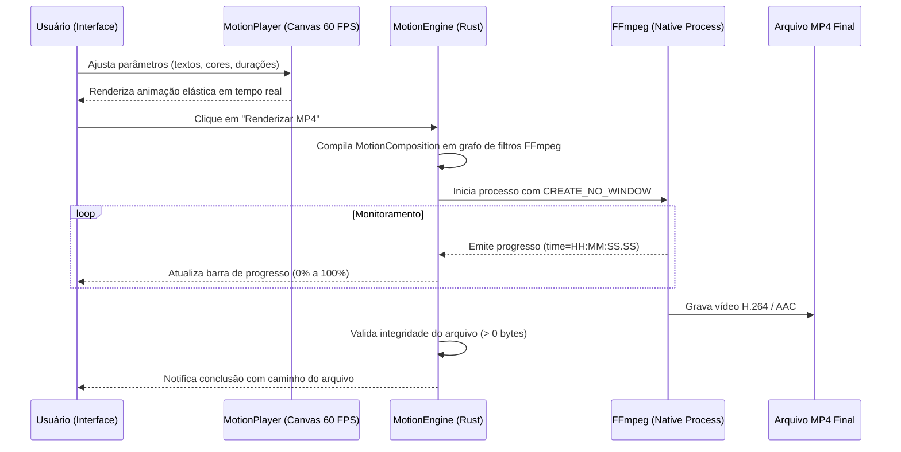

# Arce Motion Engine (AME) — Arquitetura de Motion Design

Este documento detalha o motor de motion design **Arce Motion Engine (AME)**, a análise de licenças de mercado (Remotion) e o pipeline de pré-visualização e renderização MP4.

---

## 1. Análise de Licenciamento: Remotion vs Motor Próprio

O **Remotion** é uma excelente biblioteca de código para renderização de vídeos com React, porém sua licença (**Remotion License / Company License**) impõe restrições comerciais significativas:
- **Restrição de Faturamento:** Empresas com receita anual superior a um teto específico ou com mais de 3 funcionários são obrigadas a adquirir uma licença comercial paga (`REMOTION_LICENSE_KEY`).
- **Dependência Pesada:** Distribuir o motor de renderização do Remotion em um executável desktop exige embutir Node.js, Chromium e Puppeteer (um overhead de mais de 350 MB no instalador e alto consumo de memória RAM).

### A Solução Adotada pelo Arce Tools:
Implementamos o **Arce Motion Engine (AME)**:
1. **100% Livre e Limpo de Licenças:** O motor nativo utiliza HTML5 Canvas/SVG acelerado por hardware para pré-visualização fluida a 60 FPS e FFmpeg nativo (já gerenciado pelo `DependencyManager`) para renderização final de vídeo.
2. **Leve e Autônomo:** Não exige navegadores externos (Chromium), Puppeteer ou Node.js instalados na máquina do usuário.
3. **Interoperabilidade Total com Remotion:** Para desenvolvedores e usuários avançados que já possuem licença ou ambiente Remotion, o AME inclui uma função de exportação que gera o código completo `Root.tsx` e `Composition.tsx` com 1 clique.

---

## 2. Pipeline de Renderização

---

## 3. Fórmulas de Animação e Easing

O motor suporta três categorias de curvas de movimento:

### 3.1 Ease In-Out Cúbico
$$f(t) = \begin{cases} 4t^3, & \text{se } t < 0.5 \\ 1 - \frac{(-2t + 2)^3}{2}, & \text{se } t \ge 0.5 \end{cases}$$

### 3.2 Spring / Elastic Damping
Para animações de preço saltando e entrada de logotipo:
$$f(t) = 2^{-10t} \cdot \sin\left(\left(10t - 0.75\right) \cdot \frac{2\pi}{3}\right) + 1$$

---

## 4. Presets de Resolução Suportados

| Formato | Resolução | FPS | Canal Alvo |
| :--- | :--- | :--- | :--- |
| **Vertical (9:16)** | $1080 \times 1920$ | 30 / 60 | Instagram Reels, TikTok, YouTube Shorts |
| **Horizontal (16:9)** | $1920 \times 1080$ | 30 / 60 | YouTube, Apresentações de Produto, TV |
| **Quadrado (1:1)** | $1080 \times 1080$ | 30 / 60 | Feed Instagram, LinkedIn, Banners de Anúncio |
