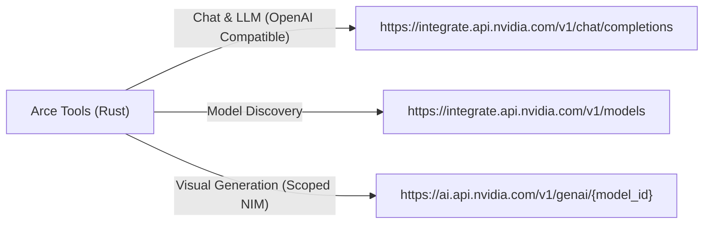

# NVIDIA AI Provider — Especificação e Integração

Documento de arquitetura e contratos técnicos do provedor **NvidiaAIProvider** implementado em Rust no Arce Tools (`src-tauri/src/engines/nvidia.rs`).

---

## 1. Endpoints e Contratos de API

A NVIDIA disponibiliza seu catálogo de inferência na nuvem (NIM) através de domínios dedicados por modalidade:



### 1.1 Modelos de Linguagem e Planejamento (Chat)
- **Base URL:** `https://integrate.api.nvidia.com/v1`
- **Autenticação:** `Authorization: Bearer nvapi-...`
- **Endpoint:** `/chat/completions`
- **Modelos Homologados:**
  - `meta/llama-3.3-70b-instruct` (Padrão para raciocínio e redação publicitária)
  - `nvidia/nemotron-4-340b-instruct` (Direção de arte complexa)
  - `mistralai/mixtral-8x22b-instruct` (Copies ágeis e legendas dinâmicas)
  - `deepseek-ai/deepseek-r1` (Raciocínio lógico estruturado)

### 1.2 Modelos de Geração e Edição de Imagem
- **Base URL:** `https://ai.api.nvidia.com/v1/genai`
- **Endpoint:** `/{model_id}` (ex: `black-forest-labs/flux.1-schnell`)
- **Payload:**
  ```json
  {
    "prompt": "Commercial studio shot of a futuristic sneaker, 8k...",
    "width": 1024,
    "height": 1024,
    "steps": 4,
    "cfg_scale": 3.5,
    "seed": 42,
    "samples": 1
  }
  ```
- **Resposta:**
  ```json
  {
    "artifacts": [
      {
        "base64": "iVBORw0KGgoAAAANSUhEUgAA...",
        "finishReason": "SUCCESS"
      }
    ]
  }
  ```

---

## 2. Tratamento Estruturado de Erros e Rate Limits

| Código HTTP | Código Interno | Diagnóstico | Tratamento no Arce Tools |
| :--- | :--- | :--- | :--- |
| **401 Unauthorized** | `NVIDIA_INVALID_KEY` | Chave de API inválida, expirada ou com formato incorreto. | Alerta visual no painel orientando a gerar nova chave em build.nvidia.com. |
| **429 Too Many Requests** | `NVIDIA_RATE_LIMIT` | Limite de requisições por minuto atingido no tier gratuito. | Mensagem de backoff orientando a aguardar alguns segundos antes de nova tentativa. |
| **402 / 403 Forbidden** | `NVIDIA_QUOTA_EXCEEDED` | Modelo visual ou generativo requer créditos NVCF não disponíveis na conta. | Aviso claro de ausência de créditos para o modelo visual, mantendo as ferramentas locais (FFmpeg, Motion Studio) 100% operacionais. |
| **404 Not Found** | `NVIDIA_MODEL_UNAVAILABLE` | Modelo removido ou restrito. | Fallback para modelo padrão compatível. |

---

## 3. Segurança e Armazenamento Seguro de Chaves

1. **Vault Criptografado (`SecureVault`):**
   - No Windows, as credenciais são tratadas com criptografia per-user vinculada ao contexto de máquina e hardware (`.vault_keys.enc`), sem armazenamento de texto puro em SQLite ou arquivos de texto aberto.
   - Em memória, a chave só é decifrada no momento exato do disparo da requisição HTTP TLS 1.3.
2. **Máscara Visual:**
   - Na interface, a chave é exibida exclusivamente no formato mascarado: `nvapi-••••••••1234`.
3. **Sanitização Absoluta de Logs:**
   - A função `sanitize_error_text` contém expressão regular dedicada para expurgar qualquer padrão `nvapi-[A-Za-z0-9_-]{20,}` e cabeçalhos `Authorization: Bearer`, substituindo-os por `[PROTECTED_NVIDIA_KEY]`.
