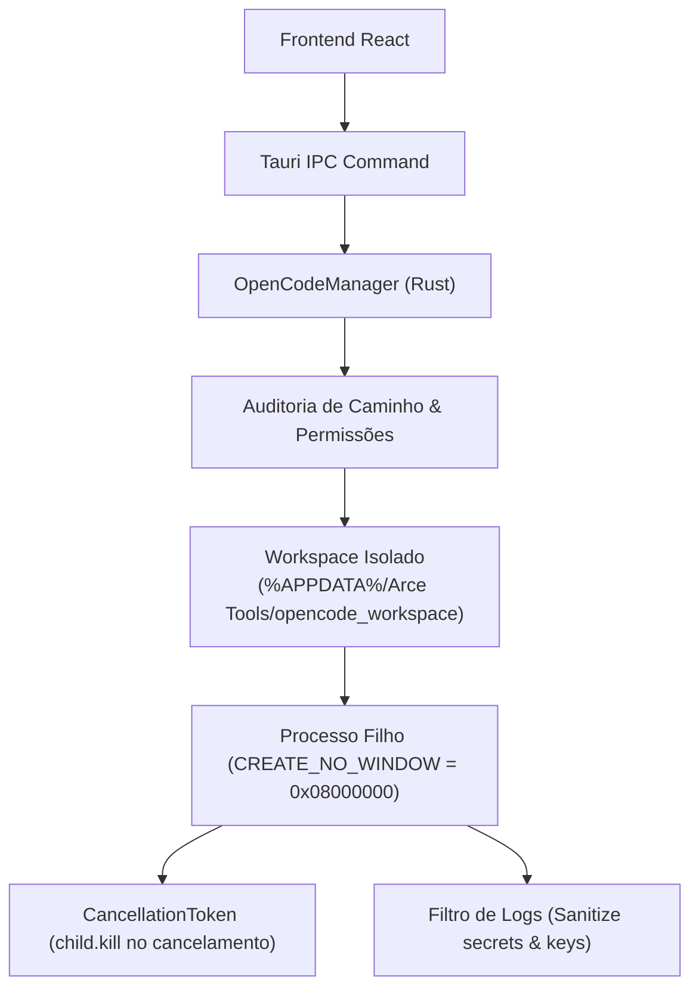

# Integração OpenCode & Orquestrador Nativo

Especificação técnica sobre a descoberta, supervisão de processos e orquestração do **OpenCode** no Arce Tools (`src-tauri/src/engines/opencode.rs`).

---

## 1. Princípios de Execução e Não-Dependência

O Arce Tools adota o princípio de **autonomia nativa**:
- O usuário final **NÃO é obrigado** a instalar Node.js global, WSL ou o OpenCode para utilizar o Creative Studio.
- Se o executável do OpenCode for detectado no sistema, o estúdio pode delegar tarefas de geração assistida em workspace isolado.
- Caso o OpenCode **NÃO** esteja instalado, o **Orquestrador Nativo em Rust** assume 100% das tarefas criativas (planejamento com LLM, seleção de skills, composição de cenas e renderização com FFmpeg). O aplicativo jamais bloqueia ou exibe erros de ausência de dependência obrigatória.

---

## 2. Descoberta Determinística no Windows

O método `find_opencode_binary` busca o executável nas seguintes localizações em ordem de prioridade:
1. `PATH` do sistema (`opencode` ou `opencode.exe`).
2. Instalação por usuário em `%LOCALAPPDATA%\Programs\OpenCode\opencode.exe`.
3. Pacote global npm em `%APPDATA%\npm\opencode.cmd`.

A verificação de versão (`probe_version`) é executada com timeout estrito de 5 segundos para impedir que processos pendentes travem a inicialização da aplicação.

---

## 3. Diretrizes de Segurança e Isolamento

1. **Janela Invisível:** Todos os comandos rodam com a flag `CREATE_NO_WINDOW = 0x08000000` no Windows, sem piscar prompts de comando pretos na tela do usuário.
2. **Escopo Restrito:** A flag `--dir` restringe o workspace exclusivamente à pasta do projeto em execução, impedindo varredura de diretórios do usuário (`C:\Users\...`).
3. **Interrupção Imediata:** Ao clicar em cancelar, o `CancellationToken` dispara `child.kill().await`, liberando memória e threads instantaneamente.
4. **Higienização de Chaves:** Nenhuma chave de API da NVIDIA é passada por argumentos de linha de comando (`args`), evitando vazamento em gerenciadores de tarefas do sistema operacional.
