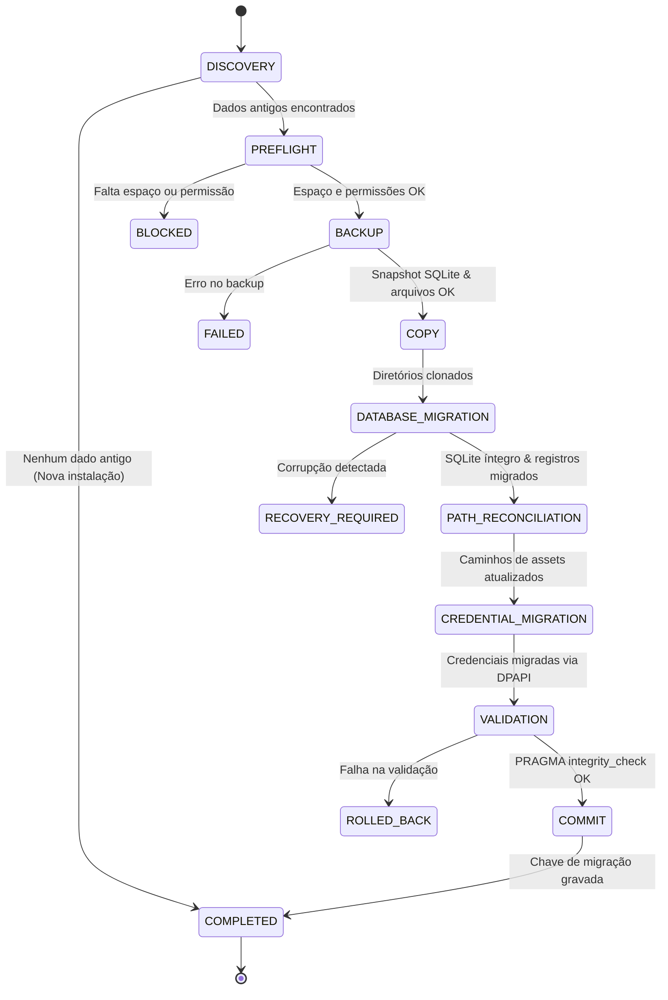

# Plano Mestre de Rebranding e Migração Segura de Dados — ToolsOnDesk
## Missão 07: Transição Arquitetural de "Arce Tools" para "ToolsOnDesk"

> [!IMPORTANT]
> **Princípio Fundamental:** Não estamos criando um novo aplicativo. Estamos renomeando e evoluindo o aplicativo existente. Todas as funcionalidades (Missões 01 a 06), dados de usuários, projetos criativos, histórico de tarefas, configurações e utilitários gerenciados devem ser integralmente preservados.
> O nome **ToolsOnDesk** é a identidade de trabalho interna adotada. Sua liberação comercial definitiva depende de validação formal de marca (INPI) e domínio.

---

## 1. Inventário de Dados e Caminhos Afetados

A auditoria inicial detalhada do código fonte e tempo de execução revelou a seguinte distribuição de dados legados no ambiente Windows 11:

### 1.1 Diretórios Persistentes Legados

| Identificador / Caminho Legado | Conteúdo / Papel Técnico | Risco na Transição |
|---|---|---|
| `%LOCALAPPDATA%\com.mateusarcedev.arce-tools\` | Diretório padrão de `app_data_dir()` retornado pelo Tauri 2 no Windows para o identificador antigo. Contém `arce_tools.db`, arquivos `arce_tools.db-wal`, `arce_tools.db-shm` e `.vault_keys.enc`. | Se o identificador mudar para `com.toolsondesk.desktop`, o Tauri 2 criará um novo diretório vazio `%LOCALAPPDATA%\com.toolsondesk.desktop\`. Sem migração, o usuário perde acesso ao banco existente. |
| `%LOCALAPPDATA%\ArceTools\binaries\` | Binários gerenciados baixados pelo `DependencyManager` (`ffmpeg.exe`, `ffprobe.exe`, `yt-dlp.exe`). | Redownload desnecessário de centenas de MBs se o caminho não for reconciliado. |
| `%LOCALAPPDATA%\ArceTools\workspace\` | Diretório de trabalho isolado do `OpenCodeManager` e renderizações temporárias. | Quebra de projetos criativos que referenciam caminhos absolutos neste diretório. |
| `%LOCALAPPDATA%\Programs\Arce Tools\` | Binário da versão instalada via NSIS (`arce-tools.exe`), desinstalador `Uninstall Arce Tools.exe`. | Duplicação de programas no Windows se a instalação antiga não for tratada de forma coordenada. |
| `%APPDATA%\Microsoft\Windows\Start Menu\Programs\Arce Tools.lnk` | Atalho no menu Iniciar do Windows. | Atalho órfão apontando para o binário antigo. |
| `HKCU\Software\Microsoft\Windows\CurrentVersion\Uninstall\Arce Tools` | Registro do instalador NSIS em "Aplicativos Instalados". | Manter duas entradas confusas caso a migração não ofereça transição assistida. |

### 1.2 Estrutura do Banco SQLite (`arce_tools.db`)

O banco SQLite opera em modo WAL (`journal_mode = WAL`) com 7 tabelas e múltiplos índices:

1. `tasks`: Fila de tarefas históricas e estados (ID, nome, op, módulo, status, progresso, source_path, target_path, options_json, error, size_mb, timestamps).
2. `history`: Registro de tarefas concluídas para exibição na UI.
3. `preferences`: Tabela chave-valor contendo preferências do usuário (`first_run_status`, temas, caminhos personalizados, flags).
4. `error_logs`: 6 índices de alta performance para auditoria de falhas, severidades e diagnósticos.
5. `creative_projects`: Metadados de projetos de imagens, motion design e vídeo (ID, título, proporção, resolução, fps, duração, prompt, style, model, skills_used, data_json, output_path, thumbnail_path).
6. `creative_assets`: Metadados de arquivos de mídia (imagens, vídeos, áudios) vinculados a projetos.
7. `creative_generation_history`: Histórico de prompts, sementes e durações para reprodução criativa.

### 1.3 Cofre de Credenciais Legado (`.vault_keys.enc`)

- **Localização:** `%LOCALAPPDATA%\com.mateusarcedev.arce-tools\.vault_keys.enc` (ou ao lado do banco legado).
- **Algoritmo Legado:** XOR stream cipher utilizando SHA-256 counter com chave derivada de `ARCE_TOOLS_SECURE_VAULT_SALT_v1` concatenada com `COMPUTERNAME`, `USERNAME` e `USERPROFILE`.
- **Limitação Identificada:** `COMPUTERNAME` e variáveis de ambiente não constituem segredo robusto.
- **Estratégia M07:** O novo cofre adotará a API criptográfica nativa do Windows (**DPAPI** via `CryptProtectData` / `CryptUnprotectData`), vinculando as chaves exclusivamente ao contexto do usuário autenticado no Windows sem expor senhas. O `MigrationManager` decodificará o cofre legado exclusivamente em memória e o re-encriptará via DPAPI no novo formato.

---

## 2. Nova Arquitetura de Diretórios: `%LOCALAPPDATA%\ToolsOnDesk\`

Para eliminar qualquer string hardcoded dispersa no código, criamos o módulo central [`paths.rs`](file:///home/mateusarcedev/projetos/arce-tools/src-tauri/src/utils/paths.rs):

```
%LOCALAPPDATA%\ToolsOnDesk\
├── database\
│   ├── toolsondesk.db
│   ├── toolsondesk.db-wal
│   └── toolsondesk.db-shm
├── binaries\
│   ├── ffmpeg.exe
│   ├── ffprobe.exe
│   └── yt-dlp.exe
├── workspace\
│   └── opencode\
├── projects\
│   └── {project_id}\
├── assets\
├── vault\
│   └── .vault_dpapi.enc
├── skills\
│   └── custom\
├── backups\
│   └── migration_{timestamp}\
│       ├── manifest.json
│       ├── arce_tools_backup.db
│       └── .vault_keys.enc.bak
├── logs\
└── cache\
```

---

## 3. As 10 Etapas do MigrationManager (Nativo Rust)

O [`MigrationManager`](file:///home/mateusarcedev/projetos/arce-tools/src-tauri/src/storage/migration.rs) é construído como uma máquina de estados estrita, atômica e idempotente:



### Detalhamento das Etapas:
1. **DISCOVERY:** Inspeciona silenciosamente a presença de `%LOCALAPPDATA%\com.mateusarcedev.arce-tools\`, `%LOCALAPPDATA%\ArceTools\`, bancos `arce_tools.db` e registros NSIS. Se já migrado (`migration_status = 'completed'` no novo banco), encerra sem custos.
2. **PREFLIGHT:** Verifica espaço em disco (mínimo de 500 MB livres na partição de AppData) e valida permissão de gravação criando/removendo um arquivo temporário com UUID.
3. **BACKUP:** Utiliza a **SQLite Online Backup API** (`sqlite3_backup`) para criar uma cópia física consistente do banco de dados antigo, mesmo com o WAL aberto e com transações ativas, gerando `arce_tools_backup.db`. Cria cópia de segurança do cofre `.vault_keys.enc`. Gera manifesto `manifest.json` com SHA-256 e contagem de registros.
4. **COPY:** Inicializa a árvore de pastas de `ToolsOnDesk` e copia os arquivos auxiliares necessários.
5. **DATABASE_MIGRATION:** Copia os dados para `toolsondesk.db` garantindo preservação de chaves primárias, chaves estrangeiras, datas ISO-8601 e integridade relacional.
6. **PATH_RECONCILIATION:** Executa varredura nas tabelas `creative_projects`, `creative_assets` e `tasks`, substituindo ocorrências de caminhos legados (`ArceTools\binaries`, `ArceTools\workspace`, `com.mateusarcedev.arce-tools`) pelos novos caminhos estruturados de `ToolsOnDesk`. Caminhos externos do usuário (ex: `C:\Users\Nome\Downloads\...`) são estritamente preservados sem alteração.
7. **CREDENTIAL_MIGRATION:** Lê o cofre legado em memória utilizando o algoritmo M06, re-criptografa as chaves via **Windows DPAPI** (`CryptProtectData`) no novo cofre `%LOCALAPPDATA%\ToolsOnDesk\vault\.vault_dpapi.enc`, e valida imediatamente uma leitura de teste.
8. **VALIDATION:** Executa `PRAGMA integrity_check` e `PRAGMA foreign_key_check` no banco de destino. Confere se a contagem de tarefas, histórico, erros, projetos e assets corresponde exatamente ao manifesto de backup.
9. **COMMIT:** Grava a preferência `migration_version = 'm07_v1'` e `migration_completed_at = ISO_TIMESTAMP`.
10. **COMPLETED:** Emite evento IPC `migration:completed` para o frontend exibir o resumo de boas-vindas com a nova identidade.

---

## 4. Requisitos de Idempotência e Segurança contra Falhas

- **Não-destrutividade:** Os arquivos legados em `%LOCALAPPDATA%\com.mateusarcedev.arce-tools` e `%LOCALAPPDATA%\ArceTools` **NUNCA são excluídos** durante a migração. Permanecem como salvaguarda permanente até confirmação expressa do usuário.
- **Tolerância a Interrupções (Queda de Energia / Crash):** Se o processo for interrompido na etapa 4 ou 5, a próxima inicialização detectará que `migration_completed` não foi assinado, limpará a pasta temporária de migração e reiniciará a partir do backup íntegro.
- **Zero Vazamento de Credenciais:** As chaves descriptografadas em memória passam por sobrescrita com zeros (`zeroize`) antes de liberar buffers. Nenhuma credencial é gravada no manifesto ou no log de migração.

---

## 5. Experiência do Usuário (Onboarding & Rebranding)

Na primeira abertura do **ToolsOnDesk**, se dados legados forem encontrados:
1. Modal amigável e refinado no Design System escuro com verde-menta:
   - *"Bem-vindo ao ToolsOnDesk"*
   - *"Encontramos dados de uma versão anterior do aplicativo. Vamos preservar seus projetos, histórico e configurações."*
   - Botões: `Migrar meus dados` (Destaque em menta) | `Ver detalhes` | `Configurar depois`.
2. Durante o processo: Barra de progresso com indicação da etapa atual (*Criando backup de segurança... Migrando banco de dados... Reconciliando caminhos... Validando integridade...*).
3. Ao concluir: Relatório real com contadores de projetos, tarefas e ferramentas externas preservadas.

---

## 6. Estratégia de Upgrade e Coexistência de Instaladores Windows (NSIS)

1. **Novo Identificador:** `com.toolsondesk.desktop`.
2. **Novo Executável:** `toolsondesk.exe`.
3. **Novo Instalador:** `ToolsOnDesk_0.1.0_x64-setup.exe`.
4. **Instalação em Modo Usuário:** `%LOCALAPPDATA%\Programs\ToolsOnDesk\`.
5. **Transição Suave de Registro:**
   - O instalador NSIS verificará a chave de registro do desinstalador antigo em `HKCU\Software\Microsoft\Windows\CurrentVersion\Uninstall\Arce Tools`.
   - Se detectada, não executará deleção cega: o novo ToolsOnDesk instalará seus arquivos limpos, executará a migração de dados no primeiro boot, e após validação, informará ao usuário que a versão legada pode ser desinstalada sem qualquer perda de dados.
