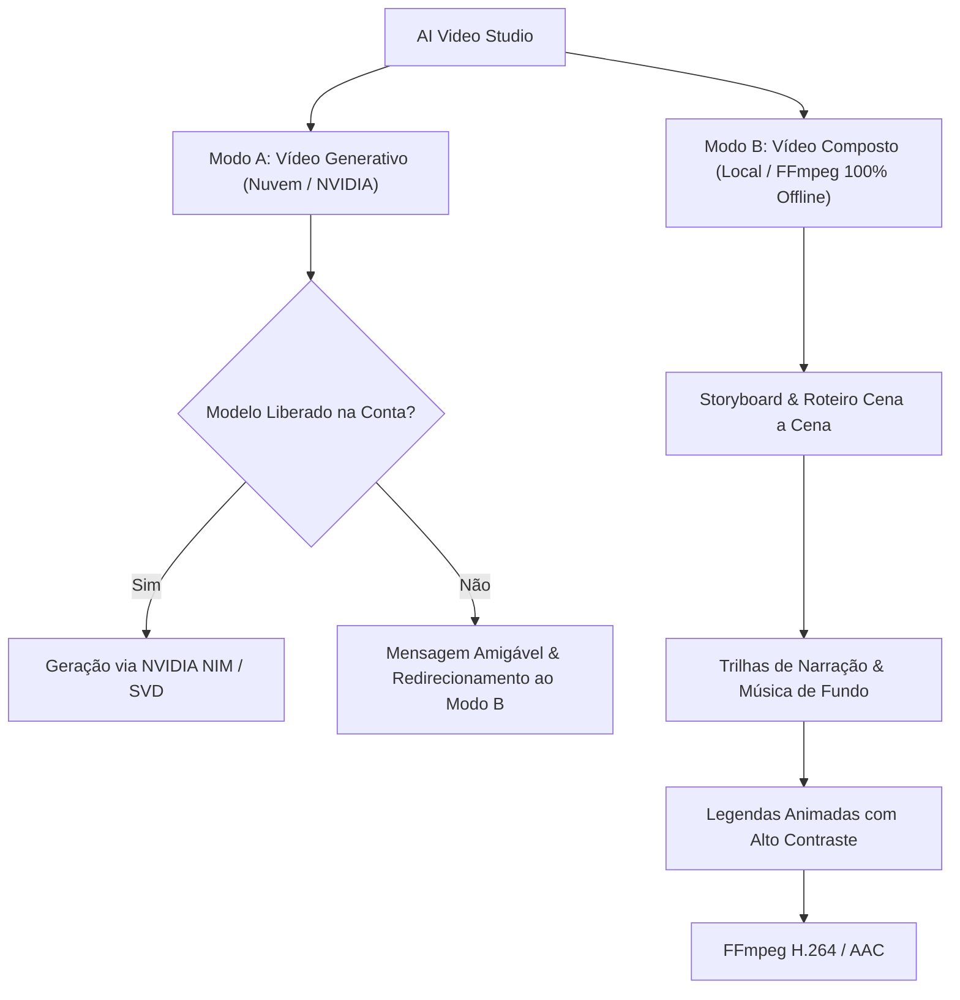

# Matriz de Compatibilidade e Modos de Vídeo

Este documento descreve a divisão entre geração de vídeo por IA na nuvem (**Modo A**) e montagem de vídeo composto local (**Modo B**).

---

## 1. Dois Modos Distintos

---

## 2. Comparativo Técnico dos Modos

| Característica | Modo A (Generativo por IA) | Modo B (Vídeo Composto Local) |
| :--- | :--- | :--- |
| **Execução** | Nuvem NVIDIA (NIM / NVCF) | Local no Computador (FFmpeg 8.1) |
| **Conexão à Internet** | Obrigatória | Desnecessária (100% Offline) |
| **Dependência de Chave** | Chave NVIDIA com créditos visuais | Nenhuma chave necessária |
| **Tempo de Processamento** | 30s a 90s por clipe | 2s a 10s (Alta velocidade) |
| **Formatos de Saída** | MP4 gerado pelo modelo | MP4 (H.264 / AAC) otimizado |
| **Controle de Elementos** | Aleatório / baseado em prompt | Controle cirúrgico de textos, marcas e tempos |
| **Custo** | Sujeito a créditos da nuvem | Gratuito e Ilimitado |

---

## 3. Diretriz de Integridade (Sem Mocks Fictícios)

O Arce Tools cumpre rigorosamente a regra do AGENTS.md:
- **NÃO simular geração de vídeo fictícia com respostas em texto:** Caso o endpoint na nuvem da NVIDIA retorne recusa por falta de permissão ou cota, o sistema declara explicitamente a limitação e oferece o Modo B local, garantindo que o usuário nunca seja enganado por simulações decorativas.
