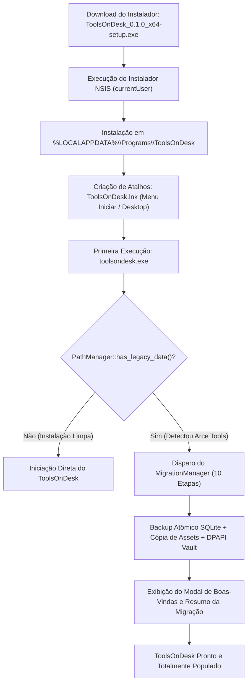

# Estratégia de Upgrade e Transição no Windows (NSIS) — ToolsOnDesk

Este documento define a engenharia de transição, upgrade e desinstalação entre o legado **Arce Tools** e o novo **ToolsOnDesk** no Windows 11/10 x64, utilizando o empacotador NSIS do Tauri 2.

---

## 1. Visão Geral e Desafios de Engenharia

Na transição de identidade de um aplicativo desktop para Windows distribuído via NSIS (Nullsoft Scriptable Install System), alterar o `productName` de `Arce Tools` para `ToolsOnDesk` e o `identifier` de `com.mateusarcedev.arce-tools` para `com.toolsondesk.desktop` acarreta implicações estruturais profundas no sistema operacional:

1. **Separação de Chaves de Desinstalação:** O Windows identifica softwares instalados através de chaves no Registro em `HKCU\Software\Microsoft\Windows\CurrentVersion\Uninstall\{GUID ou ID}`. Uma simples alteração de identificador faz o instalador padrão enxergar o novo binário como um aplicativo separado, não como uma atualização in-place.
2. **Separação de Diretórios de Instalação:** O aplicativo legado residia em `%LOCALAPPDATA%\Programs\Arce Tools\`, enquanto o novo reside em `%LOCALAPPDATA%\Programs\ToolsOnDesk\`.
3. **Persistência de Dados do Usuário:** O banco SQLite (`arce_tools.db`), chaves de API criptografadas e assets residiam em `%LOCALAPPDATA%\ArceTools\` e `%LOCALAPPDATA%\com.mateusarcedev.arce-tools\`.
4. **Atalhos no Menu Iniciar e Desktop:** Existência de atalhos apontando para `arce-tools.exe` que se tornariam obsoletos ou duplicados com a chegada de `toolsondesk.exe`.

---

## 2. Abordagem Arquitetural: Migração Segura em Runtime + NSIS Limpo

Para garantir **zero perda de dados**, **resiliência contra falhas de instalação** e **experiência transparente para o usuário final**, adotamos a estratégia de **Migração em Runtime Desacoplada do Instalador**:



### Vantagens Desta Abordagem:
- **Tolerância a Falhas:** Se o instalador for cancelado ou o PC reiniciar durante a instalação, nenhum dado do usuário terá sido tocado pelo instalador.
- **Auditoria e Logs Ricos:** A migração é executada pelo código Rust com validação de checksum SHA-256, SQLite Online Backup API e tratamento estrito de exceções (`Result<T, AppError>`).
- **Suporte a Modos Portáteis e Winget:** A migração opera identicamente se o binário for distribuído via instalador NSIS, executável portátil ou gerenciador de pacotes (WinGet / Chocolatey).
- **Preservação de Dados:** Os dados legados NUNCA são excluídos automaticamente, servindo de salvaguarda permanente caso o usuário precise de auditoria.

---

## 3. Mapeamento de Entidades no Sistema Windows

| Entidade do Sistema | Arce Tools (Legado) | ToolsOnDesk (Novo) | Tratamento na Transição |
|---|---|---|---|
| **Diretório do Executável** | `%LOCALAPPDATA%\Programs\Arce Tools\` | `%LOCALAPPDATA%\Programs\ToolsOnDesk\` | Coexistência segura; atalhos antigos podem ser desinstalados |
| **Executável Principal** | `arce-tools.exe` | `toolsondesk.exe` | Novo processo isolado |
| **Instalador NSIS** | `Arce Tools_0.1.0_x64-setup.exe` | `ToolsOnDesk_0.1.0_x64-setup.exe` | Nova assinatura e manifesto |
| **Chave de Registro de Desinstalação** | `HKCU\Software\Microsoft\Windows\CurrentVersion\Uninstall\Arce Tools` | `HKCU\Software\Microsoft\Windows\CurrentVersion\Uninstall\ToolsOnDesk` | Registros independentes |
| **Atalho do Menu Iniciar** | `%APPDATA%\Microsoft\Windows\Start Menu\Programs\Arce Tools.lnk` | `%APPDATA%\Microsoft\Windows\Start Menu\Programs\ToolsOnDesk.lnk` | Substituído / Atualizado |
| **Atalho da Área de Trabalho** | `%USERPROFILE%\Desktop\Arce Tools.lnk` | `%USERPROFILE%\Desktop\ToolsOnDesk.lnk` | Criado pelo instalador se solicitado |
| **Diretório AppData Principal** | `%LOCALAPPDATA%\ArceTools\` | `%LOCALAPPDATA%\ToolsOnDesk\` | Migrado atomicamente na 1ª execução |
| **Diretório Webview2 Data** | `%LOCALAPPDATA%\com.mateusarcedev.arce-tools\` | `%LOCALAPPDATA%\com.toolsondesk.desktop\` | Isolado pelo runtime do Tauri 2 |
| **Banco de Dados SQLite** | `%LOCALAPPDATA%\ArceTools\arce_tools.db` | `%LOCALAPPDATA%\ToolsOnDesk\database\toolsondesk.db` | Cópia via SQLite Online Backup |
| **Cofre de Credenciais** | `%LOCALAPPDATA%\ArceTools\.vault_keys.enc` | `%LOCALAPPDATA%\ToolsOnDesk\vault\credentials.enc` | Decifrado em memória e re-encriptado com DPAPI |
| **Binários Gerenciados** | `%LOCALAPPDATA%\ArceTools\binaries\` | `%LOCALAPPDATA%\ToolsOnDesk\binaries\` | Migrados com fallback transparente |

---

## 4. Comportamento do Desinstalador Legado (`Uninstall Arce Tools.exe`)

Um cenário crucial testado e documentado é: **O que acontece se o usuário rodar o desinstalador do Arce Tools após instalar o ToolsOnDesk?**

1. O desinstalador legado do Tauri NSIS remove exclusivamente:
   - Os arquivos de programa em `%LOCALAPPDATA%\Programs\Arce Tools\`.
   - O atalho `%APPDATA%\Microsoft\Windows\Start Menu\Programs\Arce Tools.lnk`.
   - A chave de registro `Uninstall\Arce Tools`.
2. O desinstalador legado **NÃO apaga** dados na pasta `%LOCALAPPDATA%\ToolsOnDesk\`.
3. Portanto, a remoção da versão legada do painel "Aplicativos Instalados" é **completamente segura** e não corrompe nem interrompe o funcionamento do ToolsOnDesk.

---

## 5. Configuração do NSIS no `tauri.conf.json`

O `tauri.conf.json` foi configurado com os seguintes parâmetros para a distribuição Windows:

```json
{
  "productName": "ToolsOnDesk",
  "version": "0.1.0",
  "identifier": "com.toolsondesk.desktop",
  "bundle": {
    "active": true,
    "targets": "all",
    "icon": [
      "icons/32x32.png",
      "icons/128x128.png",
      "icons/128x128@2x.png",
      "icons/icon.icns",
      "icons/icon.ico"
    ],
    "windows": {
      "nsis": {
        "installMode": "currentUser"
      }
    }
  }
}
```

### Por que `installMode: "currentUser"`?
- **Zero Elevação UAC:** Usuários corporativos e domésticos podem instalar sem credenciais de administrador local.
- **Acesso Direto ao AppData:** Permite que o executável e seus utilitários acessem e gerenciem os diretórios em `%LOCALAPPDATA%` sem problemas de permissão NTFS comuns em `C:\Program Files\`.
- **Compatibilidade Perfeita com DPAPI:** A chave de proteção do Windows DPAPI é vinculada à sessão do usuário corrente (`CurrentUser`), garantindo cifragem nativa e transparente.

---

## 6. Procedimento de Transição Recomendado para Usuários

Para usuários da versão de testes anterior (Arce Tools M01-M06):

1. **Baixar e Executar:** Baixe `ToolsOnDesk_0.1.0_x64-setup.exe` e execute o instalador normalmente.
2. **Abrir o ToolsOnDesk:** O aplicativo abrirá com a nova interface e exibirá o modal:
   *"Bem-vindo ao ToolsOnDesk! Migração de dados concluída."*
3. **Verificação de Dados:** Todas as tarefas anteriores, assets criativos, projetos de motion design, templates e configurações estarão disponíveis.
4. **Desinstalação Opcional do Legado:** Se desejar limpar o menu Iniciar, abra **Configurações > Aplicativos > Aplicativos Instalados**, localize `Arce Tools` e clique em **Desinstalar**. O ToolsOnDesk permanecerá intacto.

---

## 7. Rollback e Recuperação de Emergência

Caso ocorra qualquer imprevisto na máquina do usuário:
- Uma cópia de backup do banco original reside intacta em:
  `%LOCALAPPDATA%\ToolsOnDesk\backups\pre_migration_backup.db`
- A base original legada permanece intocada em:
  `%LOCALAPPDATA%\ArceTools\arce_tools.db`
- O arquivo de log e manifesto da migração é gravado em:
  `%LOCALAPPDATA%\ToolsOnDesk\manifest.json`

Essa redundância tripla garante integridade absoluta dos dados durante todo o ciclo de vida do produto.
